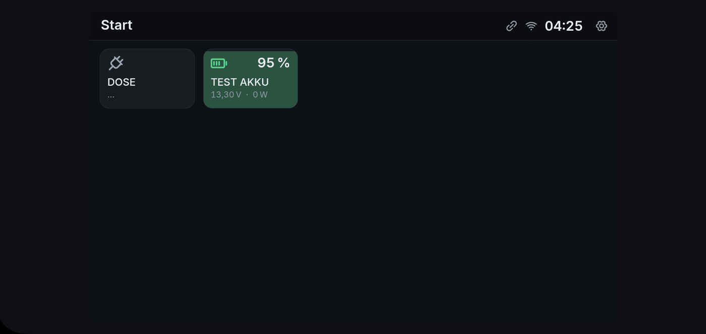

<p align="center">
  
</p>

<h1 align="center"> Simple Open Camper </h1>
<h3 align="center">S.O.C. – Touch-Panel für den Camper: Zigbee2MQTT, Gas, Wasser, Heizung und Bordtechnik – lokal, ohne Cloud, ohne Home Assistant</h3>

<p align="center">
  
  
  
  
  
  
  
  
</p>

<p align="center">
  <strong>🇩🇪 Deutsch</strong> · <a href="README_EN.md">🇬🇧 English</a>
</p>

> **Licht, Gas, Heizung und Batterie auf einem Bildschirm – direkt per MQTT, Bluetooth und LIN-Bus.**

---

## 🚧 Beta – Tester und Ideen willkommen!

Das Panel läuft im Alltag mit Zigbee2MQTT (getestet mit **131 Geräten / 73 Kacheln**). Einige Module sind nach
offenen Protokollbeschreibungen gebaut, aber **noch nicht an echter Hardware getestet**:
Mopeka mit echtem Sensor, Truma CP Plus, Truma iNet X, Alde, WLED und Cerbo GX, die meisten Akku-Typen und
Power Stations sowie die neuen Sensoren **SuperSense**, **Simarine STRx**, **Ruuvi**, **SwitchBot** und Akkus von
**CS-BATTERIES**.

Wer eines davon hat und testen mag: Rückmeldungen, Logs und Ideen sind sehr willkommen!

---

## 🚀 Über das Projekt

Ein Wand-Panel mit 7-Zoll-Touch (1024 × 600), das Lampen und Schalter aus **Zigbee2MQTT direkt per MQTT** steuert –
ohne Home Assistant dazwischen. Dazu liest es Gasflaschen, Tanks, Victron-Geräte und die Heizung im Wohnmobil.
Das Layout baust du im Browser-Editor, den das Panel selbst ausliefert.

> 💡 **So fing es an:** Im Wohnwagen nutze ich selbst Home Assistant – aber für Licht und ein paar Werte braucht
> das System auf Dauer zu viel Strom. Gesucht habe ich etwas Sparsameres. So entstand das Panel als
> **Lichtsteuerung für den SMHUB Nano**: ein Bildschirm an der Wand, der die Zigbee-Lampen direkt schaltet.
>
> Auf die Idee, mehr daraus zu machen, hat mich meine
> [Truma-LevelControl-Integration für Home Assistant](https://github.com/cyclemat/HAOS-Truma-Levelcontrol-Integration)
> gebracht: Wenn das Panel den Gasstand selbst per Bluetooth lesen kann, braucht es dafür kein Home Assistant.
> Danach kamen Tanks, Victron, die Truma-Heizung, Alde und Satelliten dazu – Stück für Stück ist daraus das
> Bordpanel für den ganzen Camper gewachsen. Daher auch der neue Name: aus dem „Zigbee-Panel“ wurde
> **Simple Open Camper**.

- 🏠 Alles läuft **lokal** auf dem Panel – keine Cloud, kein Konto
- 📶 Eigenes WLAN möglich (Router-Modus) – kein Heimnetz nötig, ideal fürs Wohnmobil
- 🧩 Jedes Zusatzmodul lässt sich in `platformio.ini` aus- oder einbauen

---

## ✨ Funktionen

**Bedienung**
- 💡 **Kacheln** zeigen die echte Lichtfarbe (Farbe, Weißton, Helligkeitsbalken). Tippen schaltet, langes Drücken
  öffnet Helligkeit, Farbtemperatur, Sättigung und Farbrad – jeweils nur, wenn das Gerät es kann.
- 🗂️ **Mehrere Seiten** (Wischen oder Reiter), jede auf Wunsch mit eigenem Hintergrundbild (z. B. Grundriss).
- ✏️ **Web-Editor** unter `http://<panel>/`: Geräte per Drag & Drop anordnen, Größen, Symbole, Seiten,
  Hintergründe, Namen, Einstellungen, Firmware-Update übers WLAN. Ohne Panel-Verbindung startet er mit Demo-Daten.
- 🔒 **Zugangspasswort** für Editor und Weboberfläche – beim ersten Öffnen wird ein eigenes festgelegt.
- ⌨️ **Einstellungen am Panel** mit deutscher Bildschirmtastatur (QWERTZ, ä ö ü ß).
- 🌍 **Oberfläche auf Deutsch, Englisch, Spanisch oder Französisch** – weitere Sprachen leicht ergänzbar.
- 🌙 **Ruhezustand**: Abdunkeln, Schwarz (schont das LCD), dunkle Uhr oder hüpfendes Logo (eigenes PNG möglich).
- 💾 **Sicherung auf der SD-Karte**: Layout, Namen, alle Einstellungen, Sensoren, Logo und Hintergründe.
- 🕐 **Uhr von Hand stellen** für den Betrieb ohne Internet; sonst per Internet oder Browser.
- 🔋 **Akkuanzeige** in der Leiste (Ladestand, geschätzt: Akkubetrieb / lädt / USB voll).

**Geräte**
- 🐝 **Zigbee2MQTT** – Lampen und Schalter, auch große Netze
- 🔌 **Shelly** (Gen1 und Gen2+) über denselben Broker
- 🌈 **WLED** über denselben Broker – Ein/Aus, Helligkeit, Farbe
- ⛽ **Truma LevelControl** per Bluetooth – bis zu vier Gasflaschen
- 🛢️ **Mopeka** per Bluetooth – bis zu vier Gas- und Tanksensoren
- ⚖️ **Senso4s** *(Beta)* – Gasflaschen-Waage Basic/Plus per Bluetooth, Füllstand in % und kg
- ☀️ **Victron** per Bluetooth („Instant Readout“) – Solarregler, Batteriemonitor, Ladebooster
- 🔋 **Victron Cerbo GX** (Venus OS) per MQTT – Solar, Netz/Landstrom, Ladegerät, Batterie (SOC) und DC-System
- 🔥 **Truma-Heizung** (Combi/VarioHeat) – über **CP Plus** (LIN-Bus) oder **iNet X** (Bluetooth)
- ♨️ **Alde-Warmwasserheizung** (Compact 3020, 3030, 3030 Plus) über den LIN-Bus
- 🔋 **Akkus mit Bluetooth-BMS** – Super B, Power Quarry/Shentec, Daly/Bulltron, JBD/Xiaoxiang, CS-BATTERIES *(Beta)*,
  JK-BMS, LiTime/Redodo/PowerQueen, Renogy, Eco-Worthy, ANT, Vatrer: Ladezustand, Spannung, Strom, Temperatur, Zellen –
  nur lesen; Kopplungs-PIN bzw. Passwort aus der Hersteller-App möglich
- ⚡ **Power Stations** per Bluetooth – Bluetti, Allpowers, Anker SOLIX, EcoFlow: Ladestand, Leistung, AC-/DC-Ausgang schalten
- 💧 **SuperSense-Tankmodul** *(Beta)* – bis zu vier Tanksensoren per Bluetooth
- 💧 **Simarine STRx** *(Beta)* – Tanksensoren STR1/STR2/STR3 per Bluetooth-Broadcast, offen oder verschlüsselt
- 🌡️ **Klima-Sensoren** *(Beta)* – **Ruuvi** Tag/Air und **SwitchBot** Meter/Meter Plus/Outdoor Meter: Temperatur,
  Luftfeuchte, Luftdruck, beim Ruuvi Air auch CO₂ und Feinstaub; das Panel hört nur mit, keine Kopplung
- 🔥 **Dieselheizung** *(Beta)* – Vevor/Hcalory, HeaterCC/AirHeater: anzeigen und bedienen (ein/aus, Stufe, Temperatur)
- 🧊 **Kühlbox** *(Beta)* – Alpicool, IceCube/Plug-in Festivals, Bodega u. a.: anzeigen und bedienen (ein/aus, Soll je Zone)
- 📡 **BTHome** *(Beta)* – Shelly BLU (Tür, Bewegung, Taster, H&T), Xiaomi mit pvvx-Firmware u. v. a., auch verschlüsselt
- 🐝 **Zigbee direkt** *(Beta, P4 und rundes Panel)* – mit dem ESP32-H2-Funkmodul ganz ohne Zigbee2MQTT: Geräte anlernen,
  Lampen, Steckdosen (mit Leistung und Verbrauch), Schalter und Sensoren als Kacheln
- 📲 **App „S.O.C. Live“** *(Beta, Android)* – das Panel aufs Handy, Tailscale eingebaut: Kacheln wie am Panel, antippen schaltet bzw. zeigt alle Werte
- 📱 **Live-Ansicht** – das Panel im Browser bzw. am Handy bedienen (`/live`), mit Passwort
- 🔐 **Tailscale** *(Beta, P4 und rundes Panel)* – Editor und Weboberfläche von unterwegs, ohne offenen Port und ohne
  Cloud: Panel per Link-Anmeldung ins eigene Tailnet
- 🧩 **Regeln** *(Beta, P4 und rundes Panel)* – Automationen mit grafischen Bausteinen (Blockly) im Editor, z. B. Bewegungslicht,
  Licht per Taster, Dimmen per Taster

**Drei Betriebsarten**

| Modus | Beschreibung |
|---|---|
| Netzwerk | Panel und Hub im Camp-WLAN |
| Router | Panel öffnet ein eigenes WLAN mit DHCP; der SMHUB Nano bucht sich ein, das Panel findet den Broker automatisch |
| Kombi | Eigenes WLAN für den Hub **und** Camp-WLAN, mit Internet-Weiterleitung (NAT) |

---

## 📋 Voraussetzungen

- Ein Panel – Vergleich siehe [Welches Panel?](#welches-panel):
  **Elecrow CrowPanel Advanced 7" (ESP32-P4)** (EC-P4-7-V1.2), **Waveshare ESP32-S3-Touch-LCD-7B** (WS-S3-7B) oder als
  kleines rundes Panel das **Elecrow CrowPanel 1,46" Rotary** (EC-S3-1.46)
- MQTT-Broker mit **Zigbee2MQTT** (z. B. SMHUB Nano)
- VS Code mit **PlatformIO** (pioarduino, Arduino-ESP32 3.x / ESP-IDF 5.x)
- Optional: microSD-Karte (FAT32/exFAT) für Hintergründe und Sicherungen
- Für CP Plus oder Alde: ein **LIN-Transceiver** (TJA1020/TJA1021/MCP2025) und ein RJ12-Kabel

---

<a id="welches-panel"></a>

## 🖥️ Welches Panel? P4 oder Waveshare

**Gerätekürzel** – im Text und in den Dateien kurz so genannt: Hersteller – Chip – Zoll – Platinen-Revision
(die Revision nur, wo sie für die Firmware zählt).

| Kürzel | Gerät |
|---|---|
| **EC-P4-7-V1.2** | Elecrow CrowPanel Advanced 7" HMI (ESP32-P4), Platine V1.2 – spätere Revisionen entsprechend V1.3 usw. |
| **WS-S3-7B** | Waveshare ESP32-S3-Touch-LCD-7B |
| **EC-S3-1.46** | Elecrow CrowPanel 1,46" Rotary (rund, ESP32-S3) |
| **CYD-ESP32-2.8** | „Cheap Yellow Display“ ESP32-2432S028R (2,8", ESP32) – Victron-Display, Satellit, Zusatzdisplay |

Beide große Panels haben 7 Zoll und 1024 × 600 Bildpunkte und laufen mit derselben Firmware und demselben Editor.
Der Unterschied liegt im Chip – und damit darin, wie viel gleichzeitig laufen kann.

| | **Elecrow CrowPanel Advanced 7" (ESP32-P4)** (EC-P4-7-V1.2) | **Waveshare ESP32-S3-Touch-LCD-7B** (WS-S3-7B) |
|---|---|---|
| Chip | ESP32-P4, 2 Kerne RISC-V, 400 MHz | ESP32-S3, 2 Kerne Xtensa LX7, 240 MHz |
| Interner RAM | 768 KB – im Betrieb **~270 KB frei** | 512 KB – im Betrieb **~45 KB frei** (mit WLAN, Zigbee, Cerbo und Bluetooth) |
| PSRAM | **32 MB** | 8 MB (Octal, 80 MHz) |
| Flash | 16 MB | 16 MB |
| WLAN / Bluetooth | eigener Funkchip **ESP32-C6** (WLAN 6, BLE 5) – entlastet den Hauptchip | im Chip selbst – WLAN und Bluetooth teilen sich RAM und Antenne mit allem anderen |
| Display | IPS, MIPI-DSI, Grafikbeschleuniger (DMA2D, Hardware-JPEG) | paralleles RGB, das Bild wird ständig aus dem PSRAM gelesen |
| Akku | kein Messpunkt am P4 – nur über eigenen Spannungsteiler (2 × 100 kΩ an GPIO 49) | Akkuanschluss mit Spannungsmessung |
| Firmware-Größe | ~78 % des App-Bereichs | ~75 % des App-Bereichs |
| Bauen | ~1–2 min (fertige Framework-Bibliotheken) | erster Build 10–20 min (Framework wird neu gebaut) |
| Umgebung | `crowpanel-p4` (Ordner `p4/`) | `waveshare-7b` |
| Bezugsquelle | [bei Amazon](https://link.amazon/B04j2pDnV) | [bei Amazon](https://www.amazon.de/dp/B0FDQXKFJ5) |

**P4 – Vorteile:** viel Reserve, alle Module gleichzeitig möglich; eingebauter MQTT-Broker (P4 und rundes Panel); Funk auf eigenem
Chip; ruhiges Bild ohne PSRAM-Engpass beim Bildaufbau; geplant: Zigbee direkt über das ESP32-H2-Funkmodul.
**P4 – Nachteile:** teurer; Akku nicht ab Werk messbar; der Funkchip C6 braucht ggf. ein Firmware-Update
(serieller Befehl `c6update`); frühe Chips (Revision v1.x) rechnen Bluetooth-Kopplungen mit dem Hardware-ECC falsch –
die Firmware rechnet diese Schlüssel deshalb automatisch in Software.

**Waveshare – Vorteile:** günstig und verbreitet; alles auf einem Chip; Akkuanschluss mit Messung, SD-Karte, Uhrenchip.
**Waveshare – Nachteile:** **interner RAM sehr knapp**; das Bild wird aus demselben PSRAM gelesen, in dem das Panel
zeichnet – bei vollen Seiten und viel Bewegung sind Streifen/Bildfehler möglich (Bildwiederholrate deshalb 25 Hz);
WLAN und Bluetooth teilen sich Speicher und Antenne.

> ⚠️ **Waveshare: nicht alles einbauen!** Der ESP32-S3 ist mit Oberfläche, WLAN, Zigbee2MQTT, Cerbo GX und Bluetooth
> **fast voll** (Stand 0.2.0: ~45 KB interner RAM frei). Bau nur die Module ein, die du wirklich brauchst
> (`[features]`, `[truma]`, `[alde]` in `platformio.ini`) – `check-all` ist nur zum Probebauen, nicht zum Hochladen.
> Schalte am Panel außerdem Bluetooth-Protokolle ab, die du nicht nutzt (z. B. iNet X ohne Kopplung): Abgeschaltete
> Module belegen keinen RAM. Wer viele Module gleichzeitig nutzen möchte, nimmt den **P4**.

**Rundes Panel – Elecrow CrowPanel 1,46" Rotary** (EC-S3-1.46; ESP32-S3R8, 8 MB PSRAM, 16 MB Flash, rund 360 × 360,
Drehknopf, LED-Ring; Umgebung `crowpanel-146`, Ordner `crowpanel146/`): kleines Panel bzw. Zusatzdisplay für eine
Kachel je Bildschirm. Ohne Einstellungsmenü – eingerichtet wird im Browser (eigenes WLAN mit Captive Portal).
Bezugsquelle: [bei Amazon](https://link.amazon/B02xEzSrj).

---

## 📦 Installation

1. VS Code und PlatformIO installieren, diesen Ordner öffnen (Pfad ohne Leerzeichen, z. B. `C:\zp\simply-open-camper`).
2. Board über die USB-C-Buchse **„UART“** anschließen – dort kommen auch die Logs an.
3. Umgebung wählen: `waveshare-7b`, `crowpanel-p4` oder `crowpanel-146` (im PlatformIO-Menü), dann
   **PlatformIO: Upload**. Beim Waveshare dauert der **erste Build 10–20 Minuten**, weil das Arduino-Framework mit
   eigenen Einstellungen neu gebaut wird (XIP aus PSRAM gegen Bildflackern, NAT für den Kombi-Modus).
4. Vor dem Hochladen fragt das Terminal nach **Enter** – Zeit zum Anstecken.
5. Danach führt das Panel durch die Einrichtung.
6. Beim ersten Öffnen des Editors (`http://<panel>/`) ein eigenes **Zugangspasswort** festlegen (ab Werk
   `panelsat`). Vergessen? Am Panel unter **Einstellungen → Netzwerk** zurücksetzen (rundes Panel: seriell `webpw`).

### 📁 Fertige Firmware ohne neu zu bauen

**Web-Flasher (am einfachsten):** Doppelklick auf **`flasher.bat`** im Projektordner (bzw. `python tools/flasher.py`).
Das startet einen kleinen Webserver nur für diesen Rechner und öffnet **http://localhost:8765/flasher/** – mit den
Bereichen **Panels** und **Satelliten und Zubehör**. Je Gerät wählbar: Firmware aus dem **GitHub-Release** oder die
hier **lokal gebaute** (neuester Stand), und **„Nur Firmware (Update)“** (Einstellungen bleiben) oder **„Komplett (neu
einrichten)“** (alles gelöscht). Gerät per USB anschließen, Knopf drücken, Anschluss wählen – Chrome oder Edge am PC.

Jeder Build legt seine Dateien zusätzlich in **`release/lokal/`** ab (nicht im Git) – je Umgebung immer nur die
neueste:

| Datei | Wofür |
|---|---|
| `<umgebung>.bin` | Komplettdatei (Bootloader, Partitionen, App) – mit esptool ab Adresse `0x0` schreiben. **Löscht die Einstellungen** (nur für neue Geräte) |
| `<umgebung>-update.bin` | nur die App – für Updates über die Weboberfläche des Geräts, oder per USB an Adresse `0x10000` (Einstellungen bleiben) |
| `esp32-updater@0x2F0000.bin` | kleiner Updater der 4-MB-Geräte, an die angegebene Adresse |
| `stand.txt` | Version und Zeitpunkt je Umgebung |

Beispiele: neues Gerät `esptool --port COM11 write-flash 0x0 release/lokal/esp32-relay16.bin`,
eingerichtetes Gerät (Einstellungen behalten) `esptool --port COM11 write-flash 0x10000 release/lokal/esp32-relay16-update.bin`

### 🛠 Wartung und Diagnose

- **Debug-Log (Fehlersuche):** in der Weboberfläche einschalten (Panel: Editor → Einstellungen → Info; Satelliten,
  Victron-Display, Zusatzdisplays: Karte „Fehlersuche“), **ab Werk aus**. Schreibt alle Meldungen der Firmware mit
  Uhrzeit mit, dazu alle 60 s Speicher, WLAN und Verbindungen (MQTT, Cerbo …) und beim Start den Grund des letzten
  Neustarts (Absturz, Watchdog, Spannungseinbruch). Mit SD-Karte (P4, Waveshare, CYD mit Kartenslot) als Dateien
  `log-NNNNN.txt` (je bis 1 MB, die letzten 10; Panel: `panel/logs`, CYD: `logs`), sonst die letzten 8–64 KB im
  Arbeitsspeicher. Ansehen, herunterladen und löschen direkt im Browser. Ausgeschaltet belegt er keinen Speicher.
- `tools/embed_web.py` packt bei jedem Build den Editor gzip-komprimiert in die Firmware.
- `tools/upload_wait.py` wartet vor dem Hochladen auf Enter (`PANEL_UPLOAD_NOWAIT=1` schaltet es ab).
- `pio run -e check-all` baut zur Probe eine Variante mit **allen** Modulen (nicht zum Hochladen gedacht).
- Nur nötig, wenn du Schriften, Icons oder den Editor änderst:

```sh
node tools/gen_icons.js        # Icons (react-icons + sharp nötig)
python3 tools/gen_fonts.py     # LVGL-Schriften aus Inter + Icons
python3 tools/build_editor.py  # web/editor.src.html -> web/editor.html
```

---

## ⚙ Konfiguration

### Module ein- und ausschalten (`platformio.ini`)

| Abschnitt | Schalter | Bedeutung |
|---|---|---|
| `[features]` | `wled = 1` | WLED über MQTT |
| | `cerbo = 1` | Victron Cerbo GX über MQTT |
| | `lang = de` | Sprache der Panel-Oberfläche: `de`, `en`, `es`, `fr` |
| | `hymer = 1` | Hymer Connect über Bluetooth (an/aus dann in den Einstellungen; Satellit: `[sat] hymer`) |
| `[truma]` | `cpplus = 0` | Truma CP Plus über LIN (Transceiver nötig) |
| | `lin_uart`, `lin_rx`, `lin_tx`, `lin_en` | LIN-Anschluss fürs CP Plus (Standard UART2) |
| | `inetx = 1` | Truma iNet X über Bluetooth (an/aus dann in den Einstellungen) |
| `[alde]` | `enabled = 0` | Alde über LIN (das Panel ist LIN-Master) |
| | `model` | `3020`, `3030` oder `3031` (= 3030 Plus) |
| | `baud`, `checksum` | 19200 / automatisch; beim 3020 ggf. 9600 |
| | `lin_uart`, `lin_rx`, `lin_tx`, `lin_en` | LIN-Anschluss (CP Plus und Alde brauchen getrennte UARTs) |
| | `red_uart`, `red_rx` | nur 3030: interner Bus zum Mitlesen (−1 = aus) |

Truma LevelControl, Mopeka und Victron sind immer eingebaut und werden am Panel unter
**Einstellungen → Gas/Heizung** bzw. **Victron** ein- und ausgeschaltet. Was aus ist, wird nicht gesucht und
belastet Funk und WLAN nicht.

### 🌍 Sprachen & Wörterbücher

| Bereich | Sprachen | Auswahl | Wörterbuch | Werkzeug |
|---|---|---|---|---|
| **Panel** (Bildschirm) | Deutsch, Englisch, Spanisch, Französisch | `lang` unter `[features]` in `platformio.ini` | `src/i18n/<kürzel>.h` | `tools/i18n_update.py` |
| **Browser-Editor** | Deutsch, Englisch | automatisch wie das Panel, oder `http://<panel>/?lang=en` | `web/i18n/<kürzel>.json` | `tools/i18n_editor.py` |

Die Texte im Quellcode sind deutsch – sie sind gleichzeitig der **Schlüssel** im Wörterbuch. Fehlt eine
Übersetzung, erscheint einfach der deutsche Text; es geht nichts kaputt. Gerätenamen werden nie übersetzt.

#### 📖 Wörterbuch des Panels (`src/i18n/<kürzel>.h`)

Eine Zeile pro Text: links deutsch (nicht ändern), rechts die Übersetzung, dahinter als Hilfe die Fundstelle.

```c
{"Einstellungen", "Settings"},                       // src/ui/ui_settings.cpp:1424
{"vor %ld Min.", "%ld min ago"},                     // src/ui/ui_gas.cpp:29
{"Kein Echo – Sensor richtig angebracht?", ""},      // leer = bleibt deutsch
```

**Neue Sprache** (z. B. Italienisch):

1. `python tools/i18n_update.py it` – legt `src/i18n/it.h` mit allen Texten an (rechts leer).
2. Die rechte Seite übersetzen.
3. In `platformio.ini` `lang = it` setzen und bauen.

#### 📖 Wörterbuch des Editors (`web/i18n/<kürzel>.json`)

Ein JSON-Objekt: deutscher Text → Übersetzung. `{}` steht für einen veränderlichen Teil (Zahl, Name …) und wird
in der Übersetzung in derselben Reihenfolge eingesetzt.

```json
{
 "Einstellungen": "Settings",
 "vor {} Min.": "{} min ago",
 "„{}“ heißt danach überall „{}“ – auch in Home Assistant.": "“{}” will then be called “{}” everywhere – including Home Assistant."
}
```

**Neue Sprache** (z. B. Französisch):

1. `python tools/i18n_editor.py fr` – legt `web/i18n/fr.json` mit allen Texten an (Übersetzungen leer).
2. Die Werte übersetzen.
3. `python tools/i18n_editor.py` erneut ausführen – baut die Wörterbücher in `web/editor.src.html` und
   `web/editor.html` ein. Danach bauen und hochladen.

#### ✍️ Regeln für Übersetzer

- **Links bzw. den Schlüssel nie ändern** – daran wird der Text im Code erkannt.
- **Platzhalter beibehalten:** im Panel `%s`, `%d`, `%u`, `%ld`, `%.1f`; im Editor `{}`. Anzahl und Reihenfolge
  müssen passen.
- **Leerzeichen am Anfang/Ende beibehalten** (z. B. `"  ·  Boiler "`) – solche Stücke werden mit anderen Texten
  zusammengesetzt.
- Die Schriften des Panels enthalten den Latin-1-Bereich (á é í ó ú ñ ç à è ê ü ß …), aber z. B. kein „œ“
  und keine nicht-lateinischen Schriften.
- **Neue Texte im Code:** `python tools/i18n_update.py` bzw. `python tools/i18n_editor.py` tragen sie in alle
  Wörterbücher ein; mit `--report` sehen sie nur nach, was noch fehlt.

Pull Requests mit neuen oder verbesserten Übersetzungen sind sehr willkommen!

### SMHUB Nano

- **Netzwerk-Modus:** Am Nano unter **Einstellungen → MQTT** „Allow External“ einschalten. Am Panel die IP des
  Nano eintragen (Port 1883, Basis-Topic `zigbee2mqtt`).
- **Router-Modus:** Am Panel **Netzwerk → Router** wählen (Panel startet neu). Am Nano unter WLAN das Panel-WLAN
  wählen (2,4 GHz) – Name und Passwort stehen am Panel. Der Editor ist dann unter `http://192.168.4.1/` erreichbar.
- **Funkkanäle:** WLAN und Zigbee teilen sich 2,4 GHz. Zigbee2MQTT nutzt standardmäßig Kanal 11 → Panel-WLAN
  auf 13 lassen. Im Kombi-Modus folgt das Panel-WLAN dem Kanal des Camp-WLANs.

---

## 📡 Geräte einrichten

### ⛽ Truma LevelControl

- Der Sensor sendet nur alle paar Minuten und erlaubt **eine Verbindung gleichzeitig**. Ist die Truma-App,
  Home Assistant oder der Victron GX gerade verbunden, versucht es das Panel beim nächsten Durchgang erneut.
- Die Suche läuft bis zu drei Minuten; Abfrageintervall 5 bis 60 Minuten (Standard 10).
- Die letzte Messung bleibt über Neustarts erhalten.

### 🛢️ Mopeka

- Unterstützt: Pro Check, Pro Plus, Pro Check Universal, Pro Check H2O, Lippert BottleCheck, Pro-200, TD40/TD200
  und die älteren Standard-Sensoren. Das Panel hört nur mit – die Mopeka-App bleibt nutzbar.
- Beim Suchen kurz die **Sync-Taste** am Sensor drücken – er wird dann als „Taste gedrückt“ markiert.
- Flaschentyp in der Detailansicht wählen: 6/11/14 kg (Europa), 20/30/40 lb (USA) oder eigene Werte (mm, kg/l).

### ⚖️ Senso4s *(Beta, ungetestet)*

- Die Gasflaschen-Waage **Senso4s Basic / Plus** steht unter der Flasche und sendet den Füllstand in % offen per
  Bluetooth (alle 15 Minuten neu). Keine Kopplung, kein Passwort, die Senso4s-App bleibt nutzbar.
- Flasche (Leergewicht, Inhalt) und Nullabgleich einmal in der **Senso4s-App** einrichten.
- Einrichten wie ein Mopeka-Sensor: Bluetooth-Protokoll **Mopeka** einschalten, **Mopeka → Suchen** – die Waage
  erscheint als „Senso4s Basic“ bzw. „Senso4s Plus“. Flaschengröße wählen, dann rechnet das Panel die kg aus.
- Hinweise der Waage stehen im Status: Nullabgleich nötig, Einstellfehler, Batterien leer, beim Plus Warnungen zu
  Temperatur, Neigung oder Bewegung.

### 🔋 Akkus und Power Stations

- Am Panel **Einstellungen → Akkus (BMS)** bzw. **Power Stations** → „Suchen“, im Editor Reiter **Akkus**.
- **App des Herstellers vorher schließen** – die meisten Akkus sprechen nur mit einem Gerät.
- Verlangt der Akku eine **Kopplungs-PIN** (z. B. Super B) oder hat er in seiner App ein **Passwort** (z. B.
  CS-BATTERIES), dieses im Feld „PIN / Passwort“ eintragen. Das Panel zeigt an, wenn der Akku danach fragt.
- **CS-BATTERIES** *(Beta, ungetestet)*: JBD-BMS mit Anmeldung – die Anmeldung der App erledigt das Panel selbst,
  nur ein eigenes Passwort muss eingetragen werden.
- **Zellspannungen:** Bei vielen Akkus sieht man jede einzelne Zelle – JBD/Xiaoxiang, CS-BATTERIES, JK-BMS, Daly/Bulltron,
  ANT, Eco-Worthy, Renogy, Vatrer und Power Quarry/Shentec. **Akku-Kachel lange drücken**: Fenster mit allen Werten,
  die der Akku liefert (Spannung, Strom, Leistung, Restzeit, Temperatur, Zyklen, Gesundheit, Kapazität, Alarme) und
  allen Zellen als Kästchen – die höchste orange, die niedrigste blau umrandet, dazu die Differenz (Δ).
- PIN/Passwort und Entfernen gibt es nur in den Einstellungen, nicht im Fenster der Kachel.
- Nur lesen – am Akku wird nichts geschaltet oder eingestellt. Power Stations: AC-/DC-Ausgang schaltbar.

### 💧 Simarine STRx-Tanksensoren *(Beta, ungetestet)*

Die Simarine-Tanksensoren **STR1** (analog), **STR2** (NMEA 2000) und **STR3** (RV-C) können ihren Füllstand per
Bluetooth senden („Broadcast“). Das Panel hört nur mit – keine Kopplung, **kein App-Key nötig**.

1. In der App **Simarine Connect** den Tank einrichten (Höhe, Inhalt, Tankart, Kalibrierung).
2. Je Sensor **Device Management → Broadcast Settings → Broadcast Mode** einschalten – **ab Werk ist er aus**.
3. Modus wählen:
   - **Open** – Füllstand, Inhalt und Tankart für jeden lesbar. Nichts weiter einzutragen; am einfachsten zum Ausprobieren.
   - **Low / Medium / High Security** – Füllstand verschlüsselt. Jeder Sensor hat **seinen eigenen Schlüssel**: in der
     App **Show Encryption Key** antippen und die **32 Zeichen** beim Hinzufügen bzw. später im Feld **PIN / Passwort**
     eintragen. Der Schlüssel ist nicht die 4-stellige Geräte-PIN der App. Bei Medium/High sendet der Sensor Inhalt und
     Tankart nicht mit – dann zeigt das Panel nur Prozent.
4. **Simarine-App schließen bzw. vom Sensor trennen** – solange ein Handy verbunden ist, sendet der Sensor nicht.
5. Am Panel **Sensoren → Sensoren suchen** (Editor: Reiter Sensoren). Der Sensor erscheint als „Simarine STRx“. Hinzufügen –
   Kachel mit Füllstand, im Detail Inhalt in Litern, Tankart und ob der Funk offen oder verschlüsselt ist.

Fehlt der Wert, steht der Grund im Status: Broadcast aus, Schlüssel fehlt, Schlüssel passt nicht. Wird der Schlüssel in
der Simarine-App neu erzeugt, den neuen eintragen. Nicht als einzige Messung für sicherheitskritische Füllstände nutzen.

### 🔥 Dieselheizung *(Beta, ungetestet)*

- China-Dieselheizungen mit Bluetooth: **Vevor/Hcalory** mit der App „AirHeaterBLE“ (auch verschlüsselte Variante) und
  **HeaterCC/AirHeater**. Namen wie BYD-…, Heater…, „Air Heater“, HC-…, BAC-…, CRONUS…, Hcalory…, boygu… werden erkannt.
- Einrichten unter **Gas/Heizung → Heizung/Kühlbox suchen** (Editor: Reiter Gas/Heizung), erscheint als „Dieselheizung“. App vorher schließen.
- Kachel: an/aus, Stufe bzw. Solltemperatur, Innenraumtemperatur; Fehler (E1…E10) rot.
- **Bedienen:** Kachel lange drücken → **Ein/Aus**, **Stufe ±**, **Solltemperatur ±**. Auf dem Victron-Display in
  der Weboberfläche (Akku-Karte).
- Sicherheit: nur Ein/Aus, Stufe und Temperatur – keine Pumpen- oder Einstellwerte. Meldet die Heizung einen Fehler,
  ist nur noch Ausschalten möglich. Abstand zwischen Befehlen mind. 0,7 s.
- Passkey der App ist ab Werk 1234; wer ihn geändert hat, trägt ihn im Feld **PIN / Passwort** ein.
- Noch nicht: Hcalory MVP1/MVP2 und Sunster (andere Protokolle).

### 🧊 Kühlbox *(Beta, ungetestet)*

- Kompressor-Kühlboxen mit den Apps **Alpicool / Car Fridge Freezer** und **IceCube / Plug-in Festivals**, auch
  Bodega, Brass Monkey u. a. (Namen WT-…, A1-…, AK1/2/3-…), ein- und zweizonig.
- Einrichten unter **Gas/Heizung → Heizung/Kühlbox suchen** (Editor: Reiter Gas/Heizung), erscheint als „Kühlbox“. Beim ersten Verbinden ggf. die
  **Settings-Taste an der Box** drücken. App vorher schließen – solange sie verbunden ist, ist die Box für andere stumm.
- Kachel: Innentemperatur groß, Soll darunter (zweite Zone daneben).
- **Bedienen:** Kachel lange drücken → **Ein/Aus**, **Soll ±** je Zone. Einstellungen werden immer aus dem zuletzt
  gelesenen Stand geschrieben, nichts geraten; Reset wird nie gesendet.

### 📡 BTHome *(Beta, ungetestet)*

- Offener Standard für viele günstige Funk-Sensoren: **Shelly BLU** (Tür/Fenster, Bewegung, Taster, H&T),
  **Xiaomi-Thermometer mit pvvx-Firmware** und viele andere. Das Panel hört nur mit, keine Kopplung.
- Einrichten unter **Sensoren → Sensoren suchen** (Editor: Reiter Sensoren), das Gerät erscheint als „BTHome“.
- Kachel: Temperatur und Feuchte, bzw. bei Tür-/Bewegungsmeldern der Zustand („Tür offen“, „Bewegung“,
  „Nässe!“ …). Taster-Ereignisse („Taster: kurz/doppelt/lang“) stehen im Zustand.
- **Verschlüsselt** (z. B. Shelly BLU mit Schlüssel): den Schlüssel (32 Zeichen, aus der Shelly-App) ins Feld
  **PIN / Passwort** eintragen.

### 🌡️ Ruuvi und SwitchBot *(Beta, ungetestet)*

- **Ruuvi Tag / Ruuvi Air** und **SwitchBot Meter, Meter Plus, Outdoor Meter** senden ihre Werte offen per Bluetooth.
  Keine Kopplung, kein Passwort, die Hersteller-App darf offen bleiben, ein SwitchBot-Hub ist nicht nötig.
- Einrichten unter **Sensoren → Sensoren suchen** (Editor: Reiter Sensoren) – der Sensor erscheint als „Ruuvi“ bzw. „SwitchBot Meter“.
- Kachel: Temperatur groß, Luftfeuchte darunter (Ruuvi Air: CO₂). Im Detail Luftdruck, Feinstaub und Batterie.

### ☀️ Victron

- In VictronConnect **Instant Readout** aktivieren (**Einstellungen → Produktinfo → Instant Readout**).
- Pro Gerät den Schlüssel aus **Details anzeigen** im Editor einfügen oder am Panel eintippen.
- Nur Anzeige – Schalten geht über Instant Readout nicht.

### 🔋 Victron Cerbo GX

- Am GX **Einstellungen → Dienste → MQTT** einschalten (unverschlüsselt, Port 1883).
- Am Panel unter **Einstellungen → Victron** oder im Editor die IP-Adresse des GX eintragen. Die Portal-ID
  erkennt das Panel selbst; ein Passwort ist nur nötig, wenn am GX eins für das lokale Netz gesetzt ist.
- Das Panel verbindet sich direkt mit dem GX (eigene MQTT-Verbindung, unabhängig vom Zigbee2MQTT-Broker),
  abonniert nur die benötigten Werte und hält den GX per Keepalive am Senden.
- Fünf Kacheln: **Solar** (PV-Leistung, Ladephase, Ertrag heute), **Netz** (Leistung, Spannung, Strombegrenzung),
  **Ladegerät** (Multi/Quattro oder Netzladegerät: Zustand, Schalter, Leistung), **Batterie** (SOC, Spannung,
  Leistung, Restlaufzeit) und **DC-System** (Verbraucher-Leistung).
- **MultiPlus/Quattro und Ladegeräte bedienen:** im Detailfenster (Kachel lange drücken) Netzstrom-Begrenzung und
  Schalter (Ein, Aus, Nur Laden, Nur Wechselrichter) – nur wenn der GX das erlaubt.
- **DC-DC-Lader am GX** (Orion XS, Orion Smart) und **Lichtmaschinenregler** (z. B. Wakespeed): je Gerät eine eigene
  Kachel mit Zustand, Eingang und Ausgang (Name vom GX). Per Bluetooth ohne GX gehen Orion XS/Smart sowieso.
- **Ein- und Ausgänge des GX** – nur was dort eingerichtet ist: **Relais** (schaltbar, wenn am GX die Funktion
  „Manuell“ gewählt ist), **Tanks** (Füllstand, Inhalt in Litern), **Temperatursensoren** (auch Luftfeuchte, z. B.
  Ruuvi) und **Digitaleingänge** (Tür, Bilge, Alarm, Generator). Sie erscheinen im Editor wie die Anschlüsse eines
  Satelliten namens **„GX“** und lassen sich aufs Panel ziehen.

### 🔥 Truma-Heizung

- **CP Plus:** LIN-Transceiver an die UART-Stiftleiste (Schalter auf „UART“), LIN an RJ12 Pin 3, Masse an Pin 5
  (am Combi oder per Verteiler). Danach am CP Plus einmal **PR SET → Init** ausführen.
  Verdrahtung im Detail: [Kabelanschlüsse](#-kabelanschlüsse-lin-bus-und-ci-bus).
- **iNet X:** In den Einstellungen das Protokoll einschalten, **„iNet X koppeln“** tippen und dann am Bedienteil
  **„Gerät hinzufügen“** öffnen (3 Minuten Zeit). Das iNet X merkt sich höchstens vier Geräte.

### ♨️ Alde

- LIN-Leitung an die **gelbe RJ12-Buchse** (Pin 4, Masse Pin 2), Modell und Pins unter `[alde]` eintragen.
  Das Panel ist hier LIN-Master (1-kΩ-Widerstand nötig) – siehe [Kabelanschlüsse](#-kabelanschlüsse-lin-bus-und-ci-bus).
- Das Panel fragt den Kessel alle 500 ms ab und sendet nur bei Änderungen – Einstellungen am Alde-Bedienteil
  bleiben gültig.
- Compact 3020 HE: nach bisherigem Stand lässt sich nur lesen, nicht steuern – nicht unterstützt.

### 🚐 Hymer Connect

- Für Fahrzeuge der Erwin Hymer Group mit **HYMER Connect** (Hymer, Bürstner, Dethleffs, Eriba, LMC, Carado …):
  Licht, Hauptschalter, Wasserpumpe, Batterie, Lithium-BMS, Frisch-/Abwasser, Solar, Landstrom, Außentemperatur –
  direkt per Bluetooth von der SCU, **ohne Cloud**.
- Am Panel unter **Einstellungen → Fahrzeug** „Hymer Connect“ einschalten, **Hymer koppeln** tippen und dann am
  Bedienteil im Fahrzeug **CONNECTION** drücken (3 Minuten Zeit). Am Satelliten geht das genauso in der Weboberfläche.
- Die Werte erscheinen im Editor wie die Anschlüsse eines Satelliten namens **„Hymer“** und lassen sich aufs Panel
  ziehen; Lichter und Schalter sind per Tippen schaltbar.
- Nur Bluetooth – ein Kabelanschluss an die SCU ist nicht vorgesehen.
- Noch **nicht an einer echten SCU getestet** – Rückmeldungen sehr willkommen.

### 🏕️ Hobby (HobbyConnect-Box oder CI-BUS) *(Beta, ungetestet)*

- Für Wohnwagen und Reisemobile von **Hobby**: Lichter (schaltbar), Bordbatterie (Spannung, Strom, Ladezustand,
  Restzeit, Temperatur), Frischwasser, Innen-/Außentemperatur, Landstrom, Heizung, Warmwasser, Kühlschrank, Klimaanlage,
  Hauptschalter – direkt am Panel, ohne App und ohne Cloud.
- **Zwei Wege**, einzeln schaltbar und **ab Werk aus** – unter **Einstellungen → Fahrzeug**:
  - **HobbyConnect-Box per Bluetooth:** einschalten, die gefundene Box antippen. Die Hobby-App auf dem Handy vorher
    trennen (die Box spricht nur mit einem Gerät).
  - **CI-BUS am LSG per Kabel** (ersetzt die Box): RS232-TTL-Wandler (z. B. MAX3232, **3,3 V**) an eine freie serielle
    Schnittstelle, Schnittstelle (UART1, UART2 …) sowie RX-/TX-Pin am Panel wählen. 115200 Baud; die Nummern der Werte
    holt das Panel selbst vom LSG. Kabelsatz „Bluetooth-Modul“ von Hobby plus Stecker für die serielle Seite.
    Waveshare 7": UART-Stiftleiste (GPIO 15/16). **Niemals RS232 (±12 V) direkt an den ESP32!**
    Verdrahtung: [Kabelanschlüsse](#-kabelanschlüsse-lin-bus-und-ci-bus).
- Die Werte erscheinen im Editor wie die Anschlüsse eines Satelliten **„Hobby“**; die Bordbatterie zusätzlich als
  **Batteriewächter-Kachel**. Am Panel legt **„Kacheln anlegen“** alles auf einmal an. Der **Hauptschalter** geht nur
  über das Kabel – Vorsicht, wenn das Panel selbst hinter dem Hauptschalter hängt.
- `LIGHT_DUSCHE`/`LIGHT_WASCH` sind je nach Fahrzeug vertauscht – Kachel einfach umbenennen. Serieller Befehl `hobby`
  zeigt alle empfangenen Werte (auch unbekannte) – bitte bei anderen Modellen mitschicken.
- Protokoll: [`docs/protokolle/hobby_ble_cibus.md`](docs/protokolle/hobby_ble_cibus.md).

### 🔌 Kabelanschlüsse (LIN-Bus und CI-BUS)

Truma CP Plus, Alde und der Hobby-CI-BUS hängen per Kabel am Panel. **Hymer Connect braucht kein Kabel** – das
läuft nur per Bluetooth zur SCU (siehe oben).

**Grundregeln**

- Die Pins des ESP32 vertragen nur **3,3 V**. Den Bus nie direkt anschließen: LIN (12 V) nur über einen
  **LIN-Transceiver**, CI-BUS (RS232, ±12 V) nur über einen **RS232-TTL-Wandler**.
- **Masse (GND)** von Panel, Wandler und Fahrzeug verbinden.
- **RX** des Panels an den **Ausgang** des Wandlers, **TX** des Panels an dessen **Eingang**. Kommt nichts an:
  RX und TX tauschen.
- Jedes Gerät braucht eine **eigene serielle Schnittstelle** (UART). UART0 ist für Log/USB reserviert.

| Gerät | Bus und Stecker | Wandler | Baud | Master | Einstellen |
|---|---|---|---|---|---|
| Truma CP Plus | LIN, RJ12: **Pin 3 = LIN, Pin 5 = Masse** (am Combi oder per Verteiler) | LIN-Transceiver | 9600 | CP Plus | `platformio.ini` → `[truma]` |
| Alde 3020/3030 | LIN, **gelbe** RJ12-Buchse: **Pin 4 = LIN, Pin 2 = Masse** | LIN-Transceiver + Master-Widerstand | 19200 | **Panel** | `platformio.ini` → `[alde]` |
| Hobby (CI-BUS) | RS232 am LSG, Kabelsatz „Bluetooth-Modul“ von Hobby | RS232-TTL-Wandler (MAX3232) | 115200 | LSG | am Panel: **Einstellungen → Fahrzeug** |
| Hymer Connect | – (Bluetooth) | – | – | – | Einstellungen → Fahrzeug |

**LIN-Transceiver** (TJA1020/TJA1021, fertiges Modul; MCP2025 sinngemäß):

| Transceiver | Anschluss |
|---|---|
| VBAT / VS | +12 V Bordnetz (über eine Sicherung) |
| GND | Fahrzeugmasse **und** GND des Panels |
| LIN | LIN-Leitung (Pin siehe Tabelle oben) |
| RXD | RX-Pin des Panels – offener Ausgang: Pull-up 4,7 kΩ nach 3,3 V (auf fertigen Modulen meist schon drauf) |
| TXD | TX-Pin des Panels |
| SLP / NSLP (MCP2025: CS) | an 3,3 V – oder an einen GPIO und diesen als `lin_en` eintragen (das Panel setzt ihn auf High) |

- **Alde:** Das Panel ist LIN-Master. Dafür gehört ein **1-kΩ-Widerstand mit Diode** (z. B. 1N4148, Anode an +12 V)
  von +12 V an die LIN-Leitung – viele Module haben dafür eine Brücke „Master“.
- **CP Plus:** Das CP Plus ist Master, das Panel antwortet nur – **kein** 1-kΩ-Widerstand, Brücke „Master“ offen.
- Alde 3030 (optional): Der interne rote Bus (Glykol-/Warmwassertemperatur) lässt sich mit einem zweiten Transceiver
  nur mithören (`red_uart`, `red_rx`).

**RS232-TTL-Wandler für den Hobby-CI-BUS** (z. B. MAX3232-Modul):

| Wandler (TTL-Seite) | Panel |
|---|---|
| VCC | **3,3 V** (nicht 5 V – sonst liegen 5 V am ESP32) |
| GND | GND |
| TXD (Ausgang) | RX-Pin |
| RXD (Eingang) | TX-Pin |

Die RS232-Seite (D-Sub 9) kommt an den Kabelsatz „Bluetooth-Modul“ von Hobby (TX, RX, Masse des LSG). Die Belegung
des Kabelsatzes steht im Projekt [BastyJuice/Hobby_Caravan_Serial_2_CI-BUS_Connectivity](https://github.com/BastyJuice/Hobby_Caravan_Serial_2_CI-BUS_Connectivity).
Kommt nichts an, RX und TX auf der RS232-Seite tauschen (Nullmodem). Schnittstelle und Pins werden am Panel gewählt
(kein Neubau nötig); der Status zeigt, ob das LSG antwortet.

**Pins je Panel**

| Panel | Anschluss | Hinweis |
|---|---|---|
| Waveshare 7B | UART-Stiftleiste, **GPIO 15/16** (Umschalter auf „UART“, nicht RS485) | Freie Pins sind knapp – die Stiftleiste reicht für **ein** Gerät (CP Plus, Alde **oder** Hobby). Doku und Wiki widersprechen sich bei der Richtung: kommt nichts an, RX/TX tauschen. |
| CrowPanel P4 | freie GPIOs der Steckleisten | Pins in `p4/platformio.ini` bzw. (Hobby) am Panel eintragen. **UART3 / GPIO 27/28** belegt das Zigbee-Funkmodul (H2) – nicht verwenden, wenn es gesteckt ist. |
| Rundes Panel 1,46" | UART-Buchse hinten (1,25 mm, 4-polig): **1 = RX (GPIO 44), 2 = TX (GPIO 43), 3 = 5 V, 4 = GND** | Dort hängt das **Zigbee-Funkmodul (H2)**, siehe unten. Die Buchse hat **5-V-Pegel** (Pegelwandler auf der Platine). |

**Zigbee-Funkmodul (ESP32-H2) am runden Panel** *(Beta, ungetestet)*: Das Modul ist für den 3,3-V-Steckplatz des P4
gebaut, die Buchse hinten am runden Panel liefert aber 5 V und 5-V-Pegel. Dazwischen gehören:

| Von der Buchse | Über | Zum H2-Modul |
|---|---|---|
| Pin 3 (5 V) | 3,3-V-Regler (z. B. AMS1117-3.3, HT7333) | 3V3 |
| Pin 4 (GND) | – | GND |
| Pin 2 (TX des Panels) | Pegelwandler 5 V → 3,3 V (z. B. BSS138-Modul) | RX des Moduls |
| Pin 1 (RX des Panels) | Pegelwandler 3,3 V → 5 V | TX des Moduls |

Danach im Browser-Editor **Einstellungen → Zigbee → „Zigbee-Modul verwenden“** einschalten (ab Werk aus) und Geräte
anlernen; dort lassen sie sich auch umbenennen, einstellen und entfernen. Neue Geräte bekommen von selbst eine Kachel.
Die Belegung stammt aus Elecrows Schaltplan – vor dem Löten nachmessen. **Nie 5 V oder 5-V-Pegel direkt an das H2!**

### 📱 Live-Ansicht (Panel im Browser bedienen)

- **`http://<panel>/live`** (bzw. Knopf **„Live“** oben im Editor) zeigt das Panel mit seinen Seiten und Kacheln im
  Browser – **Antippen schaltet**, **lange drücken** öffnet Helligkeit bzw. Ein/Aus. Werte frischen sich alle 1,5 s auf.
- Geschützt durch das **Zugangspasswort** (wie der Editor). Am Handy „Zum Startbildschirm hinzufügen“ – dann startet
  sie wie eine App; quer gehalten wird das Panel größer. Mit **Tailscale** auch von unterwegs
  (`http://<name-im-tailnet>/live`).
- Kostet am Panel nur Rechenzeit, solange jemand zuschaut; geschaltet wird über dieselben Wege wie am Bildschirm.

### 📲 App „S.O.C. Live“ (Android) *(Beta)*

Das Panel aufs Handy – zu Hause, auf dem Campingplatz und unterwegs über Mobilfunk. Die App zeigt die Kacheln **genau
so, wie das Panel sie berechnet** (Werte, Farben, Pegel), quer über den ganzen Bildschirm.

<p> </p>

- **Antippen** schaltet Licht und Steckdosen; bei Messwerten (Akku, Victron, Gas, Heizung, Sensoren) öffnet sich ein
  Fenster mit **allen Werten** – beim Akku z. B. Ladezustand, Spannung, Strom, Leistung, Temperatur und Zellen.
- **Lange drücken** auf ein dimmbares Licht: Helligkeit.
- **Tailscale ist eingebaut** – die Tailscale-App wird nicht gebraucht, kein offener Port am Router.
- Das Zugangspasswort des Panels gibst du einmal ein, die App merkt es sich (nur auf dem Handy).

**Installieren und einrichten**

1. [`release/soc-live.apk`](release/soc-live.apk) aufs Handy laden und öffnen (Android 7 oder neuer, 64 Bit;
   „Installation aus unbekannten Quellen“ einmal erlauben).
2. Hinweise lesen und bestätigen.
3. **„Mit Tailscale anmelden“** – der Browser öffnet die Tailscale-Anmeldung, das Handy erscheint als **soc-live** in
   deinem Tailnet. Noch kein Konto? **„Tailscale-Konto erstellen“** (für private Nutzung kostenlos).
4. Die App **sucht das Panel im Tailnet** und verbindet sich; bei mehreren Panels tippst du es an.
   Voraussetzung: am Panel ist Tailscale an, mit demselben Konto (siehe [Tailscale](#-tailscale--fernzugriff-von-unterwegs-p4-und-rundes-panel-beta)).
5. Beim ersten Mal fragt das Panel nach seinem Zugangspasswort – fertig.

**Ohne Tailscale** (nur im WLAN des Panels bzw. im selben Netz): beim ersten Start „Ohne Tailscale – nur im WLAN“ und
die Adresse eintragen (Panel-WLAN: `192.168.4.1`, sonst die IP aus Einstellungen → Netzwerk).

**Einstellungen:** Zurück-Taste **lange** drücken – Adresse, Tailscale an/aus, Panel neu suchen, Auth-Key (statt
Browser-Anmeldung), Bildschirm anlassen, Vollbild, gespeichertes Passwort löschen, von Tailscale abmelden.
Tailscale läuft nur, solange die App genutzt wird (nach 2 min im Hintergrund aus).

### 🔐 Tailscale – Fernzugriff von unterwegs (P4 und rundes Panel) *(Beta)*

- Bringt das Panel per [microlink](https://github.com/CamM2325/microlink) (Tailscale-kompatibler Client, MIT) in dein
  **Tailnet**. Editor und Weboberfläche sind dann von überall erreichbar – unter der 100.x-Adresse oder dem Namen
  (z. B. `http://simply-open-camper/`, mit MagicDNS), auf allen Geräten mit Tailscale (Handy, Laptop …). Das
  Zugangspasswort gilt weiter. Kein offener Port am Router, keine Cloud dazwischen.
- **Einrichten (ab Werk aus):**
  1. Im Browser-Editor **Einstellungen → Netzwerk** ganz nach unten zu **„Tailscale (Beta)“**.
  2. **„Panel ins Tailnet bringen“** einschalten. Ohne Auth-Key erscheint nach ein paar Sekunden der Knopf
     **„Bei Tailscale anmelden“** – Link öffnen, mit dem Tailscale-Konto anmelden, das Gerät bestätigen. Alternativ
     einen **Auth-Key** aus dem Tailscale-Admin eintragen (Settings → Keys, am besten einmalig und kurz gültig).
  3. Fertig: Stand und Adresse stehen im Editor und am Panel unter **Einstellungen → Netzwerk**.
- Der Auth-Key und die Schlüssel des Panels bleiben **nur im Panel** (nicht in der Firmware, nicht im Repo).
  **„Abmelden“** löscht sie – danach das alte Gerät im Tailscale-Admin entfernen. Gerätename im Tailnet: Feld
  „Gerätename im Tailnet“ (sonst der Netzwerkname des Panels).
- **Getestet (P4):** im Heim-WLAN direkt verbunden (Editor in 0,3 s), über Handy-Hotspot/Mobilfunk über das
  Tailscale-Relais in Frankfurt (Ping 150–200 ms, Editor in 4–5 s, auch mehrere Abrufe gleichzeitig). Rundes Panel:
  gebaut, noch ungetestet.
- Kostet etwa 105 KB Flash und gut 40 KB internen RAM – nur, wenn eingeschaltet. Nicht beim Waveshare (zu wenig
  interner RAM) und nicht bei den kleinen Displays/Satelliten (kein PSRAM). Headscale kann microlink, im Panel aber
  noch nicht einstellbar.
- Tipp: Andere Geräte im Camper (Satelliten, GX, Zusatzdisplays) erreichst du von unterwegs am einfachsten über einen
  Router mit Tailscale als „Subnet Router“ (z. B. GL.iNet).

### 🖼️ Startbild

Beim Start zeigt das Panel 6 Sekunden lang ein Startbild und gibt den Speicher danach wieder frei. Standard ist das
Banner (`assets/splash.jpg`); eine eigene **`splash.jpg`** im Projektordner hat beim Bauen Vorrang. Das Bild als JPEG „baseline“ speichern (nicht „progressive“), am besten 1024×600 –
größere Bilder werden um 1/2, 1/4 oder 1/8 verkleinert.

### 🔌 Shelly per Bluetooth *(Beta, ungetestet)*

- Für **Shelly Gen2, Gen3 und Gen4** (Plus, Pro, Mini …) – ohne WLAN-Anbindung und ohne MQTT-Broker. P4, rundes Panel
  (EC-S3-1.46) und Waveshare 7B. Gen1 hat kein Bluetooth: dafür weiter Shelly über MQTT.
- Bluetooth am Shelly einschalten (Shelly-App → Einstellungen → Bluetooth).
- Panel: **Einstellungen → Shelly (BT)** einschalten, „Shellys suchen“, gefundenen Shelly hinzufügen (Name, Passwort nur
  wenn am Shelly gesetzt). Im Editor dieselbe Seite unter Einstellungen.
- Das Panel verbindet sich kurz: Stand alle 30 s, Schalten sofort (1–2 s). Schalter, Licht/Dimmer, Leistung und Energie
  erscheinen als Kacheln wie die MQTT-Shellys und gehen auch in Regeln und auf Zusatzdisplays.

### 🌈 WLED

- In WLED **Config → Sync Interfaces → MQTT** aktivieren, denselben Broker eintragen, Device Topic
  `wled/<name>` lassen. Das Panel findet die Geräte von selbst.
- Farbtemperatur und Effekte gehen über MQTT nicht – die stellst du weiter in der WLED-App ein.

---

## 🛰️ Satelliten

Ein Satellit ist ein günstiger **ESP32**, den du irgendwo im Fahrzeug verbaust – am
Gaskasten, unter dem Bett beim Frischwassertank, im Technikfach. Er liest Bluetooth-Geräte und eigene Sensoren und
schickt die Werte ans Panel. Das spart im Panel Arbeitsspeicher und Funkzeit (Bluetooth und WLAN teilen sich dort
eine Antenne) und überbrückt Strecken, die Bluetooth allein nicht schafft.

**Unterstützte Chips** – je Chip eine eigene Umgebung im PlatformIO-Menü:

| Umgebung | Chip / Board | Analog (ADC1) | I²C (Standard) | Hinweise |
|---|---|---|---|---|
| `satellite` | ESP32 (WROOM, esp32dev) | GPIO 32–39 | 21 / 22 | die meisten Pins, GPIO 34–39 nur Eingang |
| `satellite-c3` | ESP32-C3 (Super Mini, DevKitM-1) – [bei Amazon](https://link.amazon/B04vjKxhb) | GPIO 0–4 | 8 / 9 | klein, 13 freie Pins, Log über USB |
| `satellite-c3-oled` | ESP32-C3 mit 0,42"-OLED (ABrobot, 72 × 40) – [bei Amazon](https://link.amazon/B00lVYc7g) | GPIO 0–4 | 5 / 6 (mit dem OLED) | zeigt einen Sensorwert bzw. die Wasserwaage, siehe unten |
| `satellite-s3` | ESP32-S3 (DevKitC-1) | GPIO 1–10 | 8 / 9 | Log über die Buchse „UART“ |
| `satellite-c6` | ESP32-C6 (DevKitC-1, Super Mini) – [bei Amazon](https://link.amazon/B0gJnV7Pv) | GPIO 0–6 | 23 / 22 | Log über USB |

Alle brauchen mindestens 4 MB Flash. Das Web-IF zeigt nur die Pins, die der jeweilige Chip frei hat.

**ESP32-C3 mit OLED** (`satellite-c3-oled`): Das kleine Display zeigt beim Start abwechselnd einen Camper oder einen
Wohnwagen mit „S.O.C.“, danach **automatisch** – mit Lagesensor MPU-6050 eine **Wasserwaage in zwei Richtungen**
(Blase im Kreis, Neigung längs und quer), sonst die angeschlossenen Sensoren nacheinander (z. B. Temperatur), ohne
Sensor Name und Adresse des Satelliten. Fest einstellbar in der Weboberfläche (Karte „OLED“), ebenso Helligkeit und
Drehen. Der MPU-6050 kommt an dieselben Pins wie das OLED (SDA GPIO 5, SCL GPIO 6). Zum Schonen wird das OLED alle
20 Minuten kurz ganz schwarz und ganz weiß.

**16-fach-Relaisplatine** (Umgebung `satellite-relay16`, ESP32-WROOM-32E mit 2× 74HC595) –
[Relaisplatine bei Amazon](https://link.amazon/B08IzxSMo), [USB-TTL-Wandler bei Amazon](https://link.amazon/B02ciSu8U):

- Die Platine hat **keinen USB-Anschluss** – zum Flashen brauchst du einen **USB-TTL-Wandler** mit 3,3-V-Pegel:
  TX des Wandlers an RX der Platine, RX an TX, GND an GND. Zum Flashen **IO0 beim Einschalten auf GND** halten
  (bzw. BOOT drücken), danach loslassen.
- Sie braucht eine **eigene 5-V-Versorgung** – der Wandler reicht dafür nicht (beim Schalten der Relais bricht
  sonst die Spannung ein bzw. die USB-Verbindung ab). GND von Platine und Wandler verbinden.
- Spätere Updates gehen über die Weboberfläche des Satelliten, ohne Wandler.

**Was ein Satellit liest und schaltet**

| Art | Umfang | Hinweise |
|---|---|---|
| ⛽ Truma LevelControl, 🛢️ Mopeka, ☀️ Victron | per Bluetooth | dieselben Module wie im Panel |
| 💧 Tanksonden | bis 4 Tanks, je bis 5 Sonden | Stangen verschiedener Länge, jede mit eigener Prozentstufe |
| 🌡️ DS18B20 | bis 8 Fühler an einem GPIO | 1-Wire, Fühler per Knopf suchen, Korrektur je Fühler |
| 📈 Analog | bis 4 Eingänge (ADC1, siehe oben) | zwei Punkte zum Umrechnen von mV in den Wert |
| 📐 MPU-6050 (GY-521) | Neigung längs und quer | Nullpunkt per Knopf, Beruhigung siehe unten |
| 🔌 Schalter | bis 8 Ausgänge (Relais), 16 mit der Relaisplatine (`satellite-relay16`, 2× 74HC595) | aktiv Low wählbar, Zustand nach dem Start: aus / an / wie zuletzt |
| 🔘 Eingänge | bis 8 Kontakte oder Taster | Pull-up und Umkehren wählbar |

**Zwei Wege zum Panel** – am Satelliten einzeln einschaltbar (ab Werk ist beides aus):

- **UDP** im WLAN direkt ans Panel (Port 47811, Rundruf oder feste Panel-IP) – **ohne Server**. Werte und
  Schaltbefehle sind mit dem gemeinsamen **Satelliten-Passwort** verschlüsselt (AES-CTR). Die Einrichtung per Knopf
  (unten) schaltet UDP automatisch ein.
- **MQTT** über einen Broker, mit **Home-Assistant-Discovery** – die Werte erscheinen dann auch in Home Assistant.
  Topics: `panelsat/<id>/sensor/<punkt>`, schalten mit `panelsat/<id>/switch/<punkt>/set` (`ON` / `OFF` / `TOGGLE`).

Bluetooth dient nur noch zum **Einrichten** – als Datenweg war es zu langsam. Auch die ausgewerteten
Bluetooth-Geräte (Truma, Mopeka, Victron) sind ab Werk aus: am Satelliten nur einschalten, was er lesen soll.

Im Panel muss dafür `satellites = 1` unter `[features]` in der `platformio.ini` stehen (Standard).

### Einrichten

1. Firmware aufspielen: im PlatformIO-Menü die passende Umgebung wählen (`satellite`, `satellite-c3` …) und
   **Upload** klicken – oder `pio run -e satellite-c3 -t upload`. Der Satellit ist intern ein eigenes
   PlatformIO-Projekt im Ordner `satellite/` mit eigenem Paketordner; die Einträge im Panel-Menü reichen nur
   weiter. So installieren sich Panel und Satellit nicht gegenseitig das Framework neu.
2. Mit dem Panel verbinden – am einfachsten **per Knopf** (siehe unten), sonst über das eigene WLAN des Satelliten.
3. Im Web-IF des Satelliten die Bluetooth-Geräte und die GPIOs belegen. Das Web-IF zeigt zu jedem Pin, was er kann,
   warnt bei Startpins, Boot-Taste und LED und bei doppelter Belegung.

#### 🔘 Per Knopf mit dem Panel verbinden (empfohlen)

So kommt ein neuer Satellit ohne Tippen von WLAN-Daten ins Netz – ähnlich wie bei Shelly oder Hue:

1. Am Panel unter **Einstellungen → Geräte → Satelliten** auf **„Neuen Satelliten hinzufügen“** tippen (im Editor:
   Reiter **Satelliten → „Neuen Satelliten suchen“**). Das Panel sucht dann 3 Minuten lang per Bluetooth.
2. Am Satelliten die **BOOT-Taste 3 Sekunden halten** (ESP32/S3: GPIO 0, C3/C6: GPIO 9). Hat er keine Taste:
   **3× schnell hintereinander Strom aus/an**. Er ist dann **3 Minuten** lang per Bluetooth zum Einrichten sichtbar.
3. Er erscheint als **„Satellite-…“** – antippen bzw. **„Einrichten“**.
4. Das Panel verbindet sich per Bluetooth, handelt mit dem Satelliten einen geheimen Schlüssel aus (ECDH P-256) und
   überträgt **verschlüsselt** (AES-256):
   - den **WLAN-Zugang** – passend zur Betriebsart des Panels:

     | Panel-Betriebsart | Der Satellit bekommt |
     |---|---|
     | Camp-WLAN (Panel ist Teilnehmer) | Zugang zu **diesem** Netz |
     | Router (Panel spannt das Netz auf) | Zugang zum **Panel-WLAN** |
     | Kombi | das **Panel-WLAN** (bleibt gleich, auch auf einem anderen Campingplatz) |
     | WLAN aus | **keine Einrichtung** – Satelliten brauchen ein WLAN |

   - das **Satelliten-Passwort** des Panels, damit beide sofort zusammenpassen,
   - den **MQTT-Broker** des Panels (Adresse, Port, Benutzer, Passwort) – nur wenn das Panel einen nutzt. Der
     Satellit sendet dann zusätzlich per MQTT (auch an Home Assistant).
5. Der Satellit verbindet sich, **meldet seine IP-Adresse** zurück (das Panel zeigt sie an), startet neu und spricht
   das Panel ab dann per **UDP** an (mit Broker zusätzlich per MQTT).

Die Daten gehen nur nach dem Tastendruck am Gerät und nur verschlüsselt über die Luft – aus der Ferne lässt sich
einem Satelliten so kein fremdes WLAN unterschieben. Ändert sich am Panel die Betriebsart oder das Netz: am
Satelliten einfach erneut BOOT halten und neu einrichten. Abschaltbar beim Bauen mit `-DSAT_PAIR=0` (spart Flash).

#### Über das eigene WLAN des Satelliten

Ohne WLAN-Zugang öffnet der Satellit das WLAN **„SOC-Satellite-…“** (Passwort `panelsat`). Verbinden – die Seite
öffnet sich meist von selbst, sonst **http://4.3.2.1/**. Beim ersten Öffnen ein eigenes Zugangspasswort vergeben, dann
WLAN, Weg zum Panel (UDP) und das Satelliten-Passwort einstellen (dasselbe wie am Panel). Das eigene WLAN des
Satelliten öffnet sich auch jederzeit mit 3× schnell aus/an.

Am Panel nimmt **Antippen** eines Satelliten in der Liste ihn auch wieder heraus (**Entfernen**), im Editor heißt das
**Vergessen**.

### 💧 Tanksonden

Mehrere Edelstahl-Stangen verschiedener Länge im Tank plus eine gemeinsame Masse-Stange. Steht Wasser an einer Sonde,
leitet es zur Masse; angezeigt wird die höchste Stufe mit Kontakt (z. B. 20 / 40 / 60 / 80 / 100 %).

- **Je Sonde ein GPIO** – am einfachsten. Die Masse-Stange kommt an GND oder an einen eigenen GPIO.
  Für Module mit Transistor gibt es „Kontakt = High“.
- **Widerstandsleiter an einem Analog-Pin** – alle Sonden über Widerstände an einem Pin. Im Web-IF trägst du je Stufe
  die gemessene Spannung ein, der Satellit wählt die nächstliegende.
- **Gegen Korrosion** bekommen die Sonden nur beim Messen kurz Strom (eigenes Intervall, Standard 60 s) und sind
  sonst stromlos. Jede Sonde wird dreimal gelesen, es zählt die Mehrheit.
- Ist eine höhere Sonde nass und eine niedrigere trocken, meldet der Satellit den Wert als **unplausibel** – meist
  eine verschmutzte Stange oder ein Kabelfehler.

### 📐 Neigung beruhigen (MPU-6050)

Im Camper wackelt immer etwas: Jemand läuft herum, der Wind drückt. Damit der Wert nicht springt, glättet der
Satellit in mehreren Stufen – alles im Web-IF einstellbar:

| Stufe | Standard | Wirkung |
|---|---|---|
| Tiefpass im Sensor | 5 Hz | filtert Vibrationen schon im MPU-6050 |
| Median | letzte 5 Werte | einzelne Ausreißer fallen weg |
| Zeitfilter | 2 s | gleitender Mittelwert (0 = aus) |
| Totband | 0,2° | kleinere Änderungen werden nicht gemeldet |
| Nur bei Stillstand | ab 3 °/s | dreht sich der Sensor (Gyro), bleibt der letzte Wert stehen, bis 1 s Ruhe ist |

Den **Nullpunkt** setzt du per Knopf, wenn das Fahrzeug gerade steht. Achsen tauschen und umkehren geht ebenfalls,
falls die Platine anders herum eingebaut ist.

---

## 🏠 Home Assistant

Das Panel braucht kein Home Assistant – arbeitet aber gut mit ihm zusammen. Wer HA nutzt, kann das Panel auch als
**Bedienteil für Home Assistant** einsetzen.

| Richtung | Was | Stand |
|---|---|---|
| **Satelliten → HA** | Alle Satelliten melden sich per MQTT-Discovery selbst an: Tanksonden, Temperaturen, Relais (schaltbar), Eingänge, Wasserwaage, Zusatzsensoren und ihre Bluetooth-Sensoren | ✅ funktioniert |
| **Zigbee2MQTT → HA** | wie gewohnt über Zigbee2MQTT selbst | ✅ funktioniert |
| **Panel → HA** | Das Panel meldet seine **lokalen** Geräte per MQTT-Discovery: Gasflaschen (Truma LevelControl, Mopeka), Victron per Bluetooth, Akkus und Power Stations, Zigbee-Geräte am H2-Funkmodul, Heizung (iNet X, CP Plus, Alde), Hymer, Regeln (an/aus) | 🚧 in Arbeit |
| **HA → Panel** | Das Panel als HA-Bedienteil: Lampen, Schalter, Szenen, Skripte und Sensoren aus Home Assistant als Kacheln – über die HA-API mit Zugangstoken, auch in den Regeln nutzbar | 🚧 in Arbeit |

### 🔁 Kein Daten-Kreislauf

Damit kein Wert im Kreis läuft (Panel → HA → Panel → HA …), gelten feste Regeln:

- Das Panel meldet an HA **nur, was direkt am Panel hängt** (Bluetooth, H2-Funkmodul, Heizungsbus, Regeln).
- Was das Panel **schon per MQTT bekommt**, meldet es **nicht** weiter: Zigbee2MQTT-Geräte, Cerbo GX, Satelliten und
  Zusatzdisplays (die melden sich selbst bzw. haben eigene HA-Integrationen).
- Werte, die das Panel **aus Home Assistant** holt, gehen **nie** zurück an HA.
- Topics unter `homeassistant/` liest das Panel nie als Eingang.
- In der HA-Auswahl im Editor sind Geräte ausgeblendet, die vom Panel selbst oder von seinen Satelliten stammen –
  die gibt es auf dem Panel ja schon direkt.

---

## 📟 Victron-Display (eigene kleine Firmware)

Für alle, die nur **Victron und den Gasvorrat** sehen wollen, gibt es eine schlanke Firmware für das 2,8"-Display
ESP32-2432S028R („Cheap Yellow Display“, CYD-ESP32-2.8, rund 15 €): Cerbo GX per WLAN, Victron-Geräte, Truma LevelControl, Mopeka,
Akkus mit Bluetooth-BMS und Power Stations, dazu als Beta SuperSense, Simarine STRx, Ruuvi und SwitchBot – als Kacheln, ohne großes
Panel. **Deutsch oder Englisch.** Dieselbe Firmware gibt es auch für das Waveshare 7" mit Einstellungen am Bildschirm.

- **⚡ [Web-Flasher](https://cyclemat.github.io/simply-open-camper-victron-beta/)** – im Browser (Chrome/Edge) aufspielen,
  Sprache dort wählen
- Code, Anleitung und fertige Dateien: [simply-open-camper-victron-beta](https://github.com/cyclemat/simply-open-camper-victron-beta)
- Hier im Projekt: Umgebungen `satellite-cyd-victron` (Deutsch) und `satellite-cyd-victron-en` (Englisch)

## ⚠ Bekannte Einschränkungen

| Problem | Stellschraube |
|---|---|
| Bild flackert/driftet | `LCD_PCLK_HZ` in `src/app_config.h` auf 21 oder 18 MHz senken |
| Touch gespiegelt/gedreht | `TOUCH_SWAP_XY`, `TOUCH_INVERT_X/Y` in `src/app_config.h` |
| Bounce-Buffer-Artefakte | `LCD_BOUNCE_BUFFER_PX` auf 0 setzen |
| Kein MQTT im Router-Modus | Am Nano „Allow External“ an? Läuft der Broker? Status steht unter **Info** |
| SD-Karte wird nicht erkannt | FAT32/exFAT formatieren, Panel neu starten; notfalls `SD_FREQ_KHZ` senken |
| Panel startet bei großen Zigbee-Netzen neu | Log über „UART“ ansehen; „Interner RAM knapp“ zeigt, wo es eng wird |
| Kein Log am PC | Kabel an die Buchse **„UART“**, nicht an „USB“ |
| Umlaute fehlen | `python3 tools/gen_fonts.py` erneut ausführen |
| `IncompatiblePlatform … 6.2.0-post.1` | Im PlatformIO-Python `pioarduino==6.2.0` installieren (pioarduino-Issue #563) |
| `whitespace character in project paths` | Projekt in einen Pfad ohne Leerzeichen legen |

- Die Platine meldet nicht, ob USB-Strom anliegt – die Anzeige „USB / Akku“ ist eine Schätzung aus dem
  Spannungsverlauf. Einen Uhrenchip hat die 7B nicht; ohne Internet geht die Zeit bei Stromausfall verloren.
- Die UART-Stiftleiste der 7B teilt sich die Schnittstelle mit RS485 (Umschalter auf der Platine).

---

## 🔌 REST-API

Vom Editor genutzt, auch für eigene Skripte:

| Endpunkt | Zweck |
|---|---|
| `GET /api/info`, `GET /api/devices` | Zustand des Panels, Geräteliste |
| `GET\|POST /api/layout` | Layout (`?force=1` bei Konflikt) |
| `POST /api/rename` | `{ieee, name}` in Zigbee2MQTT umbenennen |
| `GET\|POST /api/bg?page=<id>&fmt=jpg` | Hintergrund (JPEG 1024 × 600, `&delete=1`) |
| `GET\|POST /api/backup` | `{"create":true}`, `{"restore":"<name>"}`, `{"delete":"<name>"}` |
| `GET\|POST /api/settings` | Einstellungen, inkl. `{"ble":{"truma","mopeka","victron","inetx"}}` |
| `POST /api/wifi`, `/api/time`, `/api/refresh`, `/api/reboot`, `/api/saver` | WLAN, Uhrzeit, Neu laden, Neustart, Ruhezustand |
| `POST /api/ota` | Firmware-Update (firmware.bin) |
| `GET\|POST /api/saver_logo?fmt=bin\|png` | Eigenes Logo (`&delete=1`) |
| `GET\|POST /api/truma` | `{"scan":true}`, `{"measure":"<mac>"}`, `{"add":{mac,type,name}}`, `{"remove"}`, `{"rename"}`, `{"interval"}` |
| `GET\|POST /api/mopeka` | `{"scan":true}`, `{"add":{mac,name,tank}}`, `{"remove"}`, `{"rename"}`, `{"tank":{mac,tank,empty,full,capacity}}` |
| `GET\|POST /api/victron` | `{"scan":true}`, `{"add":{mac,key,name}}`, `{"key":{mac,key}}`, `{"remove"}`, `{"rename"}` |
| `GET\|POST /api/heat` | `{"src":"cpplus"\|"inetx"\|"alde", "heat":{on,target,mode}, "water", "energy":{e,power}, "clock", "pair", "forget"}` |

---

## 🧩 Protokoll & verwandte Projekte

Für die Geräte-Protokolle dienten diese offenen Projekte als Vorlage. Übernommen wurde jeweils die
**Beschreibung des Protokolls** (Byte-Aufbau, Konstanten, Abläufe) – der Code hier ist eine eigene Umsetzung in C++.
Ausnahmen stehen in `src/third_party/` (fremder Code bzw. Daten, unverändert mit Lizenzhinweis) und sind unten
gekennzeichnet. Vielen Dank an die Autorinnen und Autoren!

| Modul (Datei) | Vorlage | Lizenz der Vorlage | Genutzt für |
|---|---|---|---|
| Truma LevelControl (`src/truma.cpp`) | [cyclemat/HAOS-Truma-Levelcontrol-Integration](https://github.com/cyclemat/HAOS-Truma-Levelcontrol-Integration) | GPL-3.0 | Passwort/RC4-Schlüssel, Mess-Ablauf |
| Mopeka (`src/mopeka.cpp`) | [esphome/esphome](https://github.com/esphome/esphome) – `mopeka_pro_check`, `mopeka_std_check` | GPL-3.0 (C++) / MIT (Python) | Paketaufbau Pro/Standard, Temperaturkorrektur, Echo-Auswertung, Flaschenmaße |
| | [Bluetooth-Devices/mopeka-iot-ble](https://github.com/Bluetooth-Devices/mopeka-iot-ble) | MIT | Modellliste, Medien-Koeffizienten (Luft, Wasser) |
| Truma CP Plus (`src/truma_cpplus.cpp`) | [danielfett/inetbox.py](https://github.com/danielfett/inetbox.py) | GPL-3.0 | LIN-Rahmen, Diagnosedienste, Statuspuffer, Kodierung |
| | [Fabian-Schmidt/esphome-truma_inetbox](https://github.com/Fabian-Schmidt/esphome-truma_inetbox) | GPL-3.0 | Anmeldung, Puffer-Layouts, Timing auf dem ESP32 |
| | [muccc/WomoLIN](https://github.com/muccc/WomoLIN) | siehe Projekt | frühe Entschlüsselung des Truma-LIN-Protokolls (über die beiden obigen) |
| Truma iNet X (`src/truma_inetx.cpp`) | [rpodgorny/hass-truma-inetx](https://github.com/rpodgorny/hass-truma-inetx) | GPL-3.0; die enthaltenen Protokolldateien stammen aus [daaaaan/truma-inetx-ble](https://github.com/daaaaan/truma-inetx-ble) **ohne Lizenzangabe** | GATT-Merkmale, Übertragungsablauf, Rahmen, Themen/Parameter |
| Alde (`src/alde.cpp`) | [daviddootson/alde_3030_plus](https://github.com/daviddootson/alde_3030_plus) | MIT | Bus-Aufbau, Steuer- und Infoblock, roter Bus (Glykol/Warmwasser) |
| | [holdestmade/esphome-alde-3020](https://github.com/holdestmade/esphome-alde-3020) | MIT | 3020-Besonderheiten, Prüfsummen-Erkennung, Zeitverhalten |
| | [darenshaw/truma-inet-x-to-alde-3020](https://github.com/darenshaw/truma-inet-x-to-alde-3020), [inetbox.py Issue #28](https://github.com/danielfett/inetbox.py/issues/28) | GPL-3.0 / – | Hinweise zu Modellen und Grenzen (3020 HE) |
| Hymer Connect (`src/hymer.cpp`, `src/hymer_tls.cpp`) | [Facetti/hymer-connect-ha-ble](https://github.com/Facetti/hymer-connect-ha-ble), [BetaHydri/hymer-connect-ha](https://github.com/BetaHydri/hymer-connect-ha) | MIT | GATT-Dienste, TLS-Profil, PIA-Rahmen, Sensor-Karten; die sieben Abo-Nachrichten sind wörtlich übernommen |
| Tailscale (`src/tailscale.cpp`, `src/third_party/microlink/`) | [CamM2325/microlink](https://github.com/CamM2325/microlink) (enthält wireguard-lwip, BSD-3-Clause) | MIT | Tailscale-kompatibler Client, unverändert übernommen (nur Einstellungen statt Kconfig) |
| Hobby (`src/hobby.cpp`) | [AndreasKirsten79/hobby-caravan-pi](https://github.com/AndreasKirsten79/hobby-caravan-pi) (mit [paveltresnak/hobby-caravan-esphome-ble](https://github.com/paveltresnak/hobby-caravan-esphome-ble)) | keine Angabe | nur Protokollwissen: BLE-Dienst, Anmeldung, Teilstücke, Befehle |
| | [BastyJuice/Hobby_Caravan_Serial_2_CI-BUS_Connectivity](https://github.com/BastyJuice/Hobby_Caravan_Serial_2_CI-BUS_Connectivity) | MIT | CI-BUS seriell: Anmeldung, Befehle, Variablentabelle |
| WLED (`src/wled.cpp`) | [WLED – MQTT-Schnittstelle](https://kno.wled.ge/interfaces/mqtt/) | EUPL-1.2 (WLED) | Topics und Befehle |
| Cerbo GX (`src/cerbo.cpp`) | [victronenergy/dbus-flashmq](https://github.com/victronenergy/dbus-flashmq), [dbus-API im Victron-Wiki](https://github.com/victronenergy/venus/wiki/dbus) | siehe Projekt | Topics, Keepalive, Pfade der Werte |
| Victron Smart Lithium, Smart BatteryProtect (`src/victron.cpp`) | [keshavdv/victron-ble](https://github.com/keshavdv/victron-ble) | Unlicense | Aufbau der Datensätze 0x05 und 0x09 |
| Akkus mit BMS (`src/bms.cpp`) | [patman15/aiobmsble](https://github.com/patman15/aiobmsble) | Apache-2.0 | Erkennung, Rahmen und Werte für Daly/Bulltron, JBD, JK, LiTime/Redodo, Eco-Worthy, ANT, Vatrer, Super B Epsilon V2 |
| | [mr-manuel/venus-os_dbus-serialbattery](https://github.com/mr-manuel/venus-os_dbus-serialbattery) | AGPL-3.0 | Protokolle JBD, JK-BMS (JK02), LiTime |
| | Unterlagen vom Hersteller bzw. eigene Analyse der Apps | – | Super B (ältere Akkus), Power Quarry/Shentec, CS-BATTERIES (Anmeldung), SuperSense |
| Ruuvi (`src/bms.cpp`) | [ruuvi/ruuvi-sensor-protocols](https://github.com/ruuvi/ruuvi-sensor-protocols) | siehe Projekt | Datenformate 3, 5 und 6 (Werbepakete) |
| Simarine STRx (`src/bms.cpp`) | [Simarine/strx-ble-broadcast-protocol](https://github.com/Simarine/strx-ble-broadcast-protocol) | siehe Projekt | Werbepakete, Metadaten, AES-CCM-Verschlüsselung |
| Dieselheizung (`src/bms.cpp`) | [Spettacolo83/diesel-heater-ble](https://github.com/Spettacolo83/diesel-heater-ble), [homeassistant-diesel-heater](https://github.com/Spettacolo83/homeassistant-diesel-heater), [mSoftMS/AirHeater-BLE](https://github.com/mSoftMS/AirHeater-BLE) | MIT | Rahmen AA55/AA66/ABBA, XOR-Schlüssel, Befehle, Erkennung |
| Kühlbox (`src/bms.cpp`) | [klightspeed/BrassMonkeyFridgeMonitor](https://github.com/klightspeed/BrassMonkeyFridgeMonitor), [deeteeppg/bodega-bluetooth-le-hass](https://github.com/deeteeppg/bodega-bluetooth-le-hass) | MIT | Rahmen, Status, Befehle |
| | Analyse der App IceCube / Plug-in Festivals (Unterlage des Nutzers) | – | Set-Aufbau nach Modell, Bind |
| BTHome (`src/bms.cpp`) | [bthome.io](https://bthome.io), [Bluetooth-Devices/bthome-ble](https://github.com/Bluetooth-Devices/bthome-ble) | MIT | Objekttabelle, Verschlüsselung |
| Senso4s (`src/mopeka.cpp`) | [ksanislo/senso4s_ble](https://github.com/ksanislo/senso4s_ble) | Apache-2.0 | Werbepakete, Fehler- und Warncodes |
| SwitchBot (`src/bms.cpp`) | [OpenWonderLabs/SwitchBotAPI-BLE](https://github.com/OpenWonderLabs/SwitchBotAPI-BLE) | siehe Projekt | Werbepakete der Thermo-Hygrometer |
| Renogy (`src/bms.cpp`) | [cyrils/renogy-bt](https://github.com/cyrils/renogy-bt) | GPL-3.0 | Modbus-Register Laderegler, DC-DC-Lader, Akku, Wechselrichter |
| | [IAmTheMitchell/renogy-ble](https://github.com/IAmTheMitchell/renogy-ble) | Apache-2.0 | Geräteerkennung, Smart Shunt 300, Akku Pro |
| Power Stations (`src/bms_ps.inc`) | [Patrick762/bluetti-bt-lib](https://github.com/Patrick762/bluetti-bt-lib), [warhammerkid/bluetti_mqtt](https://github.com/warhammerkid/bluetti_mqtt) | MIT | Bluetti: Modbus-Register, Verschlüsselung neuerer Modelle |
| | [madninjaskillz/allpowers-ble](https://github.com/madninjaskillz/allpowers-ble) | MIT | Allpowers |
| | [flip-dots/SolixBLE](https://github.com/flip-dots/SolixBLE) | MIT | Anker SOLIX: Anmeldung, Pakete, Feldzuordnung je Modell |
| | [rabits/ha-ef-ble](https://github.com/rabits/ha-ef-ble) | Apache-2.0 | EcoFlow: Anmeldung, Verschlüsselung, Datenstrukturen; **Schlüsseltabelle übernommen** (`src/third_party/ecoflow/ef_keydata.h`) |
| Rundes Panel (`src/board_crowpanel146.cpp`) | [Elecrow-RD/CrowPanel-1.46inch-HMI-ESP32-Rotary-Display](https://github.com/Elecrow-RD/CrowPanel-1.46inch-HMI-ESP32-Rotary-Display) | keine Lizenzangabe | Pinbelegung, Startbefehle des Displays |

Für die Projektlizenz siehe [Lizenz](#lizenz). Die Lizenzen der Vorlagen betreffen deren Code, nicht die
eigene Umsetzung hier. Beim iNet X ist die Herkunft
der ursprünglichen Protokoll-Analyse ohne Lizenz. Das ist keine Rechtsberatung.

### 📚 Verwendete Bibliotheken, Schriften und Symbole

| Name | Quelle | Lizenz | Wofür |
|---|---|---|---|
| LVGL 8.4 | [lvgl/lvgl](https://github.com/lvgl/lvgl) | MIT | Oberfläche aller Panels und Displays |
| ArduinoJson 7 | [bblanchon/ArduinoJson](https://github.com/bblanchon/ArduinoJson) | MIT | JSON (MQTT, Web-API, Einstellungen) |
| NimBLE-Arduino | [h2zero/NimBLE-Arduino](https://github.com/h2zero/NimBLE-Arduino) | Apache-2.0 | Bluetooth (Waveshare, rundes Panel, Satelliten, Victron-Display) |
| esp-nimble-cpp | [h2zero/esp-nimble-cpp](https://github.com/h2zero/esp-nimble-cpp) | Apache-2.0 | Bluetooth am P4 (über den Funkchip C6) |
| LovyanGFX | [lovyan03/LovyanGFX](https://github.com/lovyan03/LovyanGFX) | FreeBSD (BSD-2-Clause) | Display-Treiber rundes Panel und CYD |
| micro-ecc | [kmackay/micro-ecc](https://github.com/kmackay/micro-ecc) | BSD-2-Clause | **eingebunden** in `src/third_party/`: EcoFlow-Schlüsseltausch, Bluetooth-Kopplung am P4 |
| Arduino-ESP32 | [espressif/arduino-esp32](https://github.com/espressif/arduino-esp32) | LGPL-2.1 | Framework |
| ESP-IDF | [espressif/esp-idf](https://github.com/espressif/esp-idf) | Apache-2.0 | Framework, u. a. MQTT, HTTP-Server, NimBLE-Stack |
| ESP-Hosted | [espressif/esp-hosted-mcu](https://github.com/espressif/esp-hosted-mcu) | siehe Projekt | WLAN/Bluetooth über den C6 (P4) |
| pioarduino | [pioarduino/platform-espressif32](https://github.com/pioarduino/platform-espressif32) | Apache-2.0 | PlatformIO-Plattform |
| Inter | [rsms/inter](https://github.com/rsms/inter) | SIL OFL 1.1 | Schrift (in `src/fonts/` umgewandelt) |
| Phosphor Icons | [phosphor-icons/core](https://github.com/phosphor-icons/core) | MIT | Symbole (über react-icons, `tools/gen_icons.js`) |

---

## 📝 Änderungen

Was sich von Version zu Version geändert hat: **[CHANGELOG.md](CHANGELOG.md)**

## 🛠 Feedback & Beiträge

- Fehler und Ideen bitte als Issue melden – gern mit Log von der Buchse „UART“
- Pull Requests sind willkommen
- Mopeka, CP Plus, iNet X, Alde, WLED, Cerbo GX, Akkus, Power Stations, SuperSense, Simarine, Ruuvi oder SwitchBot getestet?
  Bitte Bescheid geben – auch wenn es nicht klappt!

---

## ❤ Support & Spenden

Das Projekt entsteht in der Freizeit. Wenn es dir hilft, freue ich mich über einen Kaffee:

**[☕ PayPal – CycleMat unterstützen](https://paypal.me/cyclemat)**

Kein Druck, keine Werbung, keine Bezahlschranke – einfach Open Source mit Leidenschaft ❤

---

<a id="lizenz"></a>

## 📜 Lizenz

**[PolyForm Noncommercial 1.0.0](LICENSE)** – Copyright © 2026 cyclemat.

- ✅ **Erlaubt:** privat nutzen, ändern, weitergeben – auch für Vereine, Forschung und Bildung, jeweils ohne
  kommerziellen Zweck.
- ❌ **Nicht erlaubt ohne gesonderte Lizenz:** die Firmware oder Geräte mit dieser Firmware verkaufen, gewerblich
  einbauen oder als Dienstleistung anbieten. **Kommerzielle Lizenzen vergibt nur der Urheber** – bei Interesse bitte
  ein Issue eröffnen.
- Teile in `src/third_party/` stehen unter eigenen, freizügigen Lizenzen (siehe [dort](src/third_party/README.md)).
- Beiträge: siehe [CONTRIBUTING.md](CONTRIBUTING.md).
- Versionen, die früher unter GPL-3.0 weitergegeben wurden, bleiben für deren Empfänger GPL-3.0.

---

## 📄 Markenhinweis

**Privates, von der Community getragenes Hobbyprojekt.**

- Nicht verbunden mit Truma, Alde, Mopeka, Victron Energy, WLED, Shelly, Waveshare, Zigbee2MQTT, Ruuvi, SwitchBot,
  CS-BATTERIES, SuperSense (comworks), Simarine oder den genannten Akku- und Power-Station-Herstellern.
- „Truma“, „LevelControl“, „iNet“, „Alde“, „Mopeka“, „Victron“, „WLED“, „Shelly“, „Ruuvi“, „SwitchBot“, „CS-BATTERIES“,
  „SuperSense“ und „Simarine“ sind Marken bzw. Namen ihrer
  Inhaber und werden nur zur Beschreibung der Kompatibilität genannt.
- Das Projekt stellt ausschließlich die Verbindung zu deinen eigenen Geräten her.
- Nutzung auf eigene Gefahr – insbesondere beim Eingriff in Heizungs- und Gasanlagen.

---

<p align="center"><strong>CycleMat · Dein Licht. Deine Heizung. Dein Panel.</strong></p>
