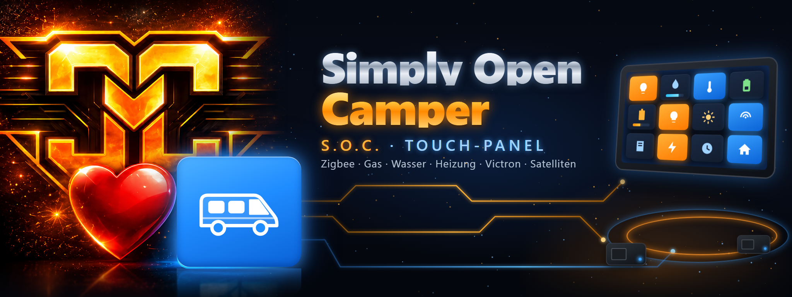

<p align="center">
  
</p>

<h1 align="center"> Simply Open Camper </h1>
<h3 align="center">S.O.C. – Touch-Panel für den Camper: Zigbee2MQTT, Gas, Wasser, Heizung und Bordtechnik – lokal, ohne Cloud, ohne Home Assistant</h3>

<p align="center">
  
  
  
  
  
  
  
  
</p>

<p align="center">
  <strong>🇩🇪 Deutsch</strong> · <a href="README_EN.md">🇬🇧 English</a>
</p>

> **Licht, Gas, Heizung und Batterie auf einem Bildschirm – direkt per MQTT, Bluetooth und LIN-Bus.**

---

## 🚧 Beta – Tester und Ideen willkommen!

Das Panel läuft im Alltag mit Zigbee2MQTT (getestet mit **131 Geräten / 73 Kacheln**). Einige Module sind nach
offenen Protokollbeschreibungen gebaut, aber **noch nicht an echter Hardware getestet**:
Mopeka mit echtem Sensor, Truma CP Plus, Truma iNet X, Alde, WLED und Cerbo GX.

Wer eines davon hat und testen mag: Rückmeldungen, Logs und Ideen sind sehr willkommen!

---

## 🚀 Über das Projekt

Ein Wand-Panel mit 7-Zoll-Touch (1024 × 600), das Lampen und Schalter aus **Zigbee2MQTT direkt per MQTT** steuert –
ohne Home Assistant dazwischen. Dazu liest es Gasflaschen, Tanks, Victron-Geräte und die Heizung im Wohnmobil.
Das Layout baust du im Browser-Editor, den das Panel selbst ausliefert.

> 💡 **So fing es an:** Im Wohnwagen nutze ich selbst Home Assistant – aber für Licht und ein paar Werte braucht
> das System auf Dauer zu viel Strom. Gesucht habe ich etwas Sparsameres. So entstand das Panel als
> **Lichtsteuerung für den SMHUB Nano**: ein Bildschirm an der Wand, der die Zigbee-Lampen direkt schaltet.
>
> Auf die Idee, mehr daraus zu machen, hat mich meine
> [Truma-LevelControl-Integration für Home Assistant](https://github.com/cyclemat/HAOS-Truma-Levelcontrol-Integration)
> gebracht: Wenn das Panel den Gasstand selbst per Bluetooth lesen kann, braucht es dafür kein Home Assistant.
> Danach kamen Tanks, Victron, die Truma-Heizung, Alde und Satelliten dazu – Stück für Stück ist daraus das
> Bordpanel für den ganzen Camper gewachsen. Daher auch der neue Name: aus dem „Zigbee-Panel“ wurde
> **Simply Open Camper**.

- 🏠 Alles läuft **lokal** auf dem Panel – keine Cloud, kein Konto
- 📶 Eigenes WLAN möglich (Router-Modus) – kein Heimnetz nötig, ideal fürs Wohnmobil
- 🧩 Jedes Zusatzmodul lässt sich in `platformio.ini` aus- oder einbauen

---

## ✨ Funktionen

**Bedienung**
- 💡 **Kacheln** zeigen die echte Lichtfarbe (Farbe, Weißton, Helligkeitsbalken). Tippen schaltet, langes Drücken
  öffnet Helligkeit, Farbtemperatur, Sättigung und Farbrad – jeweils nur, wenn das Gerät es kann.
- 🗂️ **Mehrere Seiten** (Wischen oder Reiter), jede auf Wunsch mit eigenem Hintergrundbild (z. B. Grundriss).
- ✏️ **Web-Editor** unter `http://<panel>/`: Geräte per Drag & Drop anordnen, Größen, Symbole, Seiten,
  Hintergründe, Namen, Einstellungen, Firmware-Update übers WLAN. Ohne Panel-Verbindung startet er mit Demo-Daten.
- ⌨️ **Einstellungen am Panel** mit deutscher Bildschirmtastatur (QWERTZ, ä ö ü ß).
- 🌍 **Oberfläche auf Deutsch, Englisch, Spanisch oder Französisch** – weitere Sprachen leicht ergänzbar.
- 🌙 **Ruhezustand**: Abdunkeln, Schwarz (schont das LCD), dunkle Uhr oder hüpfendes Logo (eigenes PNG möglich).
- 💾 **Sicherung auf der SD-Karte**: Layout, Namen, alle Einstellungen, Sensoren, Logo und Hintergründe.
- 🕐 **Uhr von Hand stellen** für den Betrieb ohne Internet; sonst per Internet oder Browser.
- 🔋 **Akkuanzeige** in der Leiste (Ladestand, geschätzt: Akkubetrieb / lädt / USB voll).

**Geräte**
- 🐝 **Zigbee2MQTT** – Lampen und Schalter, auch große Netze
- 🔌 **Shelly** (Gen1 und Gen2+) über denselben Broker
- 🌈 **WLED** über denselben Broker – Ein/Aus, Helligkeit, Farbe
- ⛽ **Truma LevelControl** per Bluetooth – bis zu vier Gasflaschen
- 🛢️ **Mopeka** per Bluetooth – bis zu vier Gas- und Tanksensoren
- ☀️ **Victron** per Bluetooth („Instant Readout“) – Solarregler, Batteriemonitor, Ladebooster
- 🔋 **Victron Cerbo GX** (Venus OS) per MQTT – Solar, Netz/Landstrom, Ladegerät, Batterie (SOC) und DC-System
- 🔥 **Truma-Heizung** (Combi/VarioHeat) – über **CP Plus** (LIN-Bus) oder **iNet X** (Bluetooth)
- ♨️ **Alde-Warmwasserheizung** (Compact 3020, 3030, 3030 Plus) über den LIN-Bus

**Drei Betriebsarten**

| Modus | Beschreibung |
|---|---|
| Netzwerk | Panel und Hub im Camp-WLAN |
| Router | Panel öffnet ein eigenes WLAN mit DHCP; der SMHUB Nano bucht sich ein, das Panel findet den Broker automatisch |
| Kombi | Eigenes WLAN für den Hub **und** Camp-WLAN, mit Internet-Weiterleitung (NAT) |

---

## 📋 Voraussetzungen

- **Waveshare ESP32-S3-Touch-LCD-7B** (1024 × 600, GT911-Touch, 8 MB PSRAM)
- MQTT-Broker mit **Zigbee2MQTT** (z. B. SMHUB Nano)
- VS Code mit **PlatformIO** (pioarduino, Arduino-ESP32 3.x / ESP-IDF 5.x)
- Optional: microSD-Karte (FAT32/exFAT) für Hintergründe und Sicherungen
- Für CP Plus oder Alde: ein **LIN-Transceiver** (TJA1020/TJA1021/MCP2025) und ein RJ12-Kabel

---

## 📦 Installation

1. VS Code und PlatformIO installieren, diesen Ordner öffnen (Pfad ohne Leerzeichen, z. B. `C:\zp\simply-open-camper`).
2. Board über die USB-C-Buchse **„UART“** anschließen – dort kommen auch die Logs an.
3. **PlatformIO: Upload** – der **erste Build dauert 10–20 Minuten**, weil das Arduino-Framework mit eigenen
   Einstellungen neu gebaut wird (XIP aus PSRAM gegen Bildflackern, NAT für den Kombi-Modus).
4. Vor dem Hochladen fragt das Terminal nach **Enter** – Zeit zum Anstecken.
5. Danach führt das Panel durch die Einrichtung.

### 📁 Fertige Firmware ohne neu zu bauen

Jeder Build legt seine Dateien zusätzlich in **`release/lokal/`** ab (nicht im Git) – je Umgebung immer nur die
neueste:

| Datei | Wofür |
|---|---|
| `<umgebung>.bin` | Komplettdatei (Bootloader, Partitionen, App) – mit esptool ab Adresse `0x0` schreiben |
| `<umgebung>-update.bin` | nur die App – für Updates über die Weboberfläche des Geräts |
| `esp32-updater@0x2F0000.bin` | kleiner Updater der 4-MB-Geräte, an die angegebene Adresse |
| `stand.txt` | Version und Zeitpunkt je Umgebung |

Beispiel: `esptool --port COM11 write-flash 0x0 release/lokal/esp32-relay16.bin`

### 🛠 Wartung und Diagnose

- `tools/embed_web.py` packt bei jedem Build den Editor gzip-komprimiert in die Firmware.
- `tools/upload_wait.py` wartet vor dem Hochladen auf Enter (`PANEL_UPLOAD_NOWAIT=1` schaltet es ab).
- `pio run -e check-all` baut zur Probe eine Variante mit **allen** Modulen (nicht zum Hochladen gedacht).
- Nur nötig, wenn du Schriften, Icons oder den Editor änderst:

```sh
node tools/gen_icons.js        # Icons (react-icons + sharp nötig)
python3 tools/gen_fonts.py     # LVGL-Schriften aus Inter + Icons
python3 tools/build_editor.py  # web/editor.src.html -> web/editor.html
```

---

## ⚙ Konfiguration

### Module ein- und ausschalten (`platformio.ini`)

| Abschnitt | Schalter | Bedeutung |
|---|---|---|
| `[features]` | `wled = 1` | WLED über MQTT |
| | `cerbo = 1` | Victron Cerbo GX über MQTT |
| | `lang = de` | Sprache der Panel-Oberfläche: `de`, `en`, `es`, `fr` |
| | `hymer = 1` | Hymer Connect über Bluetooth (an/aus dann in den Einstellungen; Satellit: `[sat] hymer`) |
| `[truma]` | `cpplus = 0` | Truma CP Plus über LIN (Transceiver nötig) |
| | `lin_uart`, `lin_rx`, `lin_tx`, `lin_en` | LIN-Anschluss fürs CP Plus (Standard UART2) |
| | `inetx = 1` | Truma iNet X über Bluetooth (an/aus dann in den Einstellungen) |
| `[alde]` | `enabled = 0` | Alde über LIN (das Panel ist LIN-Master) |
| | `model` | `3020`, `3030` oder `3031` (= 3030 Plus) |
| | `baud`, `checksum` | 19200 / automatisch; beim 3020 ggf. 9600 |
| | `lin_uart`, `lin_rx`, `lin_tx`, `lin_en` | LIN-Anschluss (CP Plus und Alde brauchen getrennte UARTs) |
| | `red_uart`, `red_rx` | nur 3030: interner Bus zum Mitlesen (−1 = aus) |

Truma LevelControl, Mopeka und Victron sind immer eingebaut und werden am Panel unter
**Einstellungen → Gas/Heizung** bzw. **Victron** ein- und ausgeschaltet. Was aus ist, wird nicht gesucht und
belastet Funk und WLAN nicht.

### 🌍 Sprachen & Wörterbücher

| Bereich | Sprachen | Auswahl | Wörterbuch | Werkzeug |
|---|---|---|---|---|
| **Panel** (Bildschirm) | Deutsch, Englisch, Spanisch, Französisch | `lang` unter `[features]` in `platformio.ini` | `src/i18n/<kürzel>.h` | `tools/i18n_update.py` |
| **Browser-Editor** | Deutsch, Englisch | automatisch wie das Panel, oder `http://<panel>/?lang=en` | `web/i18n/<kürzel>.json` | `tools/i18n_editor.py` |

Die Texte im Quellcode sind deutsch – sie sind gleichzeitig der **Schlüssel** im Wörterbuch. Fehlt eine
Übersetzung, erscheint einfach der deutsche Text; es geht nichts kaputt. Gerätenamen werden nie übersetzt.

#### 📖 Wörterbuch des Panels (`src/i18n/<kürzel>.h`)

Eine Zeile pro Text: links deutsch (nicht ändern), rechts die Übersetzung, dahinter als Hilfe die Fundstelle.

```c
{"Einstellungen", "Settings"},                       // src/ui/ui_settings.cpp:1424
{"vor %ld Min.", "%ld min ago"},                     // src/ui/ui_gas.cpp:29
{"Kein Echo – Sensor richtig angebracht?", ""},      // leer = bleibt deutsch
```

**Neue Sprache** (z. B. Italienisch):

1. `python tools/i18n_update.py it` – legt `src/i18n/it.h` mit allen Texten an (rechts leer).
2. Die rechte Seite übersetzen.
3. In `platformio.ini` `lang = it` setzen und bauen.

#### 📖 Wörterbuch des Editors (`web/i18n/<kürzel>.json`)

Ein JSON-Objekt: deutscher Text → Übersetzung. `{}` steht für einen veränderlichen Teil (Zahl, Name …) und wird
in der Übersetzung in derselben Reihenfolge eingesetzt.

```json
{
 "Einstellungen": "Settings",
 "vor {} Min.": "{} min ago",
 "„{}“ heißt danach überall „{}“ – auch in Home Assistant.": "“{}” will then be called “{}” everywhere – including Home Assistant."
}
```

**Neue Sprache** (z. B. Französisch):

1. `python tools/i18n_editor.py fr` – legt `web/i18n/fr.json` mit allen Texten an (Übersetzungen leer).
2. Die Werte übersetzen.
3. `python tools/i18n_editor.py` erneut ausführen – baut die Wörterbücher in `web/editor.src.html` und
   `web/editor.html` ein. Danach bauen und hochladen.

#### ✍️ Regeln für Übersetzer

- **Links bzw. den Schlüssel nie ändern** – daran wird der Text im Code erkannt.
- **Platzhalter beibehalten:** im Panel `%s`, `%d`, `%u`, `%ld`, `%.1f`; im Editor `{}`. Anzahl und Reihenfolge
  müssen passen.
- **Leerzeichen am Anfang/Ende beibehalten** (z. B. `"  ·  Boiler "`) – solche Stücke werden mit anderen Texten
  zusammengesetzt.
- Die Schriften des Panels enthalten den Latin-1-Bereich (á é í ó ú ñ ç à è ê ü ß …), aber z. B. kein „œ“
  und keine nicht-lateinischen Schriften.
- **Neue Texte im Code:** `python tools/i18n_update.py` bzw. `python tools/i18n_editor.py` tragen sie in alle
  Wörterbücher ein; mit `--report` sehen sie nur nach, was noch fehlt.

Pull Requests mit neuen oder verbesserten Übersetzungen sind sehr willkommen!

### SMHUB Nano

- **Netzwerk-Modus:** Am Nano unter **Einstellungen → MQTT** „Allow External“ einschalten. Am Panel die IP des
  Nano eintragen (Port 1883, Basis-Topic `zigbee2mqtt`).
- **Router-Modus:** Am Panel **Netzwerk → Router** wählen (Panel startet neu). Am Nano unter WLAN das Panel-WLAN
  wählen (2,4 GHz) – Name und Passwort stehen am Panel. Der Editor ist dann unter `http://192.168.4.1/` erreichbar.
- **Funkkanäle:** WLAN und Zigbee teilen sich 2,4 GHz. Zigbee2MQTT nutzt standardmäßig Kanal 11 → Panel-WLAN
  auf 13 lassen. Im Kombi-Modus folgt das Panel-WLAN dem Kanal des Camp-WLANs.

---

## 📡 Geräte einrichten

### ⛽ Truma LevelControl

- Der Sensor sendet nur alle paar Minuten und erlaubt **eine Verbindung gleichzeitig**. Ist die Truma-App,
  Home Assistant oder der Victron GX gerade verbunden, versucht es das Panel beim nächsten Durchgang erneut.
- Die Suche läuft bis zu drei Minuten; Abfrageintervall 5 bis 60 Minuten (Standard 10).
- Die letzte Messung bleibt über Neustarts erhalten.

### 🛢️ Mopeka

- Unterstützt: Pro Check, Pro Plus, Pro Check Universal, Pro Check H2O, Lippert BottleCheck, Pro-200, TD40/TD200
  und die älteren Standard-Sensoren. Das Panel hört nur mit – die Mopeka-App bleibt nutzbar.
- Beim Suchen kurz die **Sync-Taste** am Sensor drücken – er wird dann als „Taste gedrückt“ markiert.
- Flaschentyp in der Detailansicht wählen: 6/11/14 kg (Europa), 20/30/40 lb (USA) oder eigene Werte (mm, kg/l).

### ☀️ Victron

- In VictronConnect **Instant Readout** aktivieren (**Einstellungen → Produktinfo → Instant Readout**).
- Pro Gerät den Schlüssel aus **Details anzeigen** im Editor einfügen oder am Panel eintippen.
- Nur Anzeige – Schalten geht über Instant Readout nicht.

### 🔋 Victron Cerbo GX

- Am GX **Einstellungen → Dienste → MQTT** einschalten (unverschlüsselt, Port 1883).
- Am Panel unter **Einstellungen → Victron** oder im Editor die IP-Adresse des GX eintragen. Die Portal-ID
  erkennt das Panel selbst; ein Passwort ist nur nötig, wenn am GX eins für das lokale Netz gesetzt ist.
- Das Panel verbindet sich direkt mit dem GX (eigene MQTT-Verbindung, unabhängig vom Zigbee2MQTT-Broker),
  abonniert nur die benötigten Werte und hält den GX per Keepalive am Senden.
- Fünf Kacheln: **Solar** (PV-Leistung, Ladephase, Ertrag heute), **Netz** (Leistung, Spannung, Strombegrenzung),
  **Ladegerät** (Multi/Quattro oder Netzladegerät: Zustand, Schalter, Leistung), **Batterie** (SOC, Spannung,
  Leistung, Restlaufzeit) und **DC-System** (Verbraucher-Leistung).
- **MultiPlus/Quattro und Ladegeräte bedienen:** im Detailfenster (Kachel lange drücken) Netzstrom-Begrenzung und
  Schalter (Ein, Aus, Nur Laden, Nur Wechselrichter) – nur wenn der GX das erlaubt.
- **DC-DC-Lader am GX** (Orion XS, Orion Smart) und **Lichtmaschinenregler** (z. B. Wakespeed): je Gerät eine eigene
  Kachel mit Zustand, Eingang und Ausgang (Name vom GX). Per Bluetooth ohne GX gehen Orion XS/Smart sowieso.
- **Ein- und Ausgänge des GX** – nur was dort eingerichtet ist: **Relais** (schaltbar, wenn am GX die Funktion
  „Manuell“ gewählt ist), **Tanks** (Füllstand, Inhalt in Litern), **Temperatursensoren** (auch Luftfeuchte, z. B.
  Ruuvi) und **Digitaleingänge** (Tür, Bilge, Alarm, Generator). Sie erscheinen im Editor wie die Anschlüsse eines
  Satelliten namens **„GX“** und lassen sich aufs Panel ziehen.

### 🔥 Truma-Heizung

- **CP Plus:** LIN-Transceiver an die UART-Stiftleiste (Schalter auf „UART“), LIN an RJ12 Pin 3, Masse an Pin 5
  (am Combi oder per Verteiler). Danach am CP Plus einmal **PR SET → Init** ausführen.
- **iNet X:** In den Einstellungen das Protokoll einschalten, **„iNet X koppeln“** tippen und dann am Bedienteil
  **„Gerät hinzufügen“** öffnen (3 Minuten Zeit). Das iNet X merkt sich höchstens vier Geräte.

### ♨️ Alde

- LIN-Leitung an die **gelbe RJ12-Buchse** (Pin 4, Masse Pin 2), Modell und Pins unter `[alde]` eintragen.
- Das Panel fragt den Kessel alle 500 ms ab und sendet nur bei Änderungen – Einstellungen am Alde-Bedienteil
  bleiben gültig.
- Compact 3020 HE: nach bisherigem Stand lässt sich nur lesen, nicht steuern – nicht unterstützt.

### 🚐 Hymer Connect

- Für Fahrzeuge der Erwin Hymer Group mit **HYMER Connect** (Hymer, Bürstner, Dethleffs, Eriba, LMC, Carado …):
  Licht, Hauptschalter, Wasserpumpe, Batterie, Lithium-BMS, Frisch-/Abwasser, Solar, Landstrom, Außentemperatur –
  direkt per Bluetooth von der SCU, **ohne Cloud**.
- Am Panel unter **Einstellungen → Gas/Heizung** „Hymer Connect“ einschalten, **Hymer koppeln** tippen und dann am
  Bedienteil im Fahrzeug **CONNECTION** drücken (3 Minuten Zeit). Am Satelliten geht das genauso in der Weboberfläche.
- Die Werte erscheinen im Editor wie die Anschlüsse eines Satelliten namens **„Hymer“** und lassen sich aufs Panel
  ziehen; Lichter und Schalter sind per Tippen schaltbar.
- Noch **nicht an einer echten SCU getestet** – Rückmeldungen sehr willkommen.

### 🖼️ Startbild

Beim Start zeigt das Panel 6 Sekunden lang ein Startbild und gibt den Speicher danach wieder frei. Standard ist das
Banner (`assets/splash.jpg`); eine eigene **`splash.jpg`** im Projektordner hat beim Bauen Vorrang. Das Bild als JPEG „baseline“ speichern (nicht „progressive“), am besten 1024×600 –
größere Bilder werden um 1/2, 1/4 oder 1/8 verkleinert.

### 🌈 WLED

- In WLED **Config → Sync Interfaces → MQTT** aktivieren, denselben Broker eintragen, Device Topic
  `wled/<name>` lassen. Das Panel findet die Geräte von selbst.
- Farbtemperatur und Effekte gehen über MQTT nicht – die stellst du weiter in der WLED-App ein.

---

## 🛰️ Satelliten

Ein Satellit ist ein günstiger **ESP32**, den du irgendwo im Fahrzeug verbaust – am
Gaskasten, unter dem Bett beim Frischwassertank, im Technikfach. Er liest Bluetooth-Geräte und eigene Sensoren und
schickt die Werte ans Panel. Das spart im Panel Arbeitsspeicher und Funkzeit (Bluetooth und WLAN teilen sich dort
eine Antenne) und überbrückt Strecken, die Bluetooth allein nicht schafft.

**Unterstützte Chips** – je Chip eine eigene Umgebung im PlatformIO-Menü:

| Umgebung | Chip / Board | Analog (ADC1) | I²C (Standard) | Hinweise |
|---|---|---|---|---|
| `satellite` | ESP32 (WROOM, esp32dev) | GPIO 32–39 | 21 / 22 | die meisten Pins, GPIO 34–39 nur Eingang |
| `satellite-c3` | ESP32-C3 (Super Mini, DevKitM-1) | GPIO 0–4 | 8 / 9 | klein, 13 freie Pins, Log über USB |
| `satellite-s3` | ESP32-S3 (DevKitC-1) | GPIO 1–10 | 8 / 9 | Log über die Buchse „UART“ |
| `satellite-c6` | ESP32-C6 (DevKitC-1, Super Mini) | GPIO 0–6 | 23 / 22 | Log über USB |

Alle brauchen mindestens 4 MB Flash. Das Web-IF zeigt nur die Pins, die der jeweilige Chip frei hat.

**Was ein Satellit liest und schaltet**

| Art | Umfang | Hinweise |
|---|---|---|
| ⛽ Truma LevelControl, 🛢️ Mopeka, ☀️ Victron | per Bluetooth | dieselben Module wie im Panel |
| 💧 Tanksonden | bis 4 Tanks, je bis 5 Sonden | Stangen verschiedener Länge, jede mit eigener Prozentstufe |
| 🌡️ DS18B20 | bis 8 Fühler an einem GPIO | 1-Wire, Fühler per Knopf suchen, Korrektur je Fühler |
| 📈 Analog | bis 4 Eingänge (ADC1, siehe oben) | zwei Punkte zum Umrechnen von mV in den Wert |
| 📐 MPU-6050 (GY-521) | Neigung längs und quer | Nullpunkt per Knopf, Beruhigung siehe unten |
| 🔌 Schalter | bis 8 Ausgänge (Relais), 16 mit der Relaisplatine (`satellite-relay16`, 2× 74HC595) | aktiv Low wählbar, Zustand nach dem Start: aus / an / wie zuletzt |
| 🔘 Eingänge | bis 8 Kontakte oder Taster | Pull-up und Umkehren wählbar |

**Zwei Wege zum Panel** – am Satelliten einzeln einschaltbar (ab Werk ist beides aus):

- **UDP** im WLAN direkt ans Panel (Port 47811, Rundruf oder feste Panel-IP) – **ohne Server**. Werte und
  Schaltbefehle sind mit dem gemeinsamen **Satelliten-Passwort** verschlüsselt (AES-CTR). Die Einrichtung per Knopf
  (unten) schaltet UDP automatisch ein.
- **MQTT** über einen Broker, mit **Home-Assistant-Discovery** – die Werte erscheinen dann auch in Home Assistant.
  Topics: `panelsat/<id>/sensor/<punkt>`, schalten mit `panelsat/<id>/switch/<punkt>/set` (`ON` / `OFF` / `TOGGLE`).

Bluetooth dient nur noch zum **Einrichten** – als Datenweg war es zu langsam. Auch die ausgewerteten
Bluetooth-Geräte (Truma, Mopeka, Victron) sind ab Werk aus: am Satelliten nur einschalten, was er lesen soll.

Im Panel muss dafür `satellites = 1` unter `[features]` in der `platformio.ini` stehen (Standard).

### Einrichten

1. Firmware aufspielen: im PlatformIO-Menü die passende Umgebung wählen (`satellite`, `satellite-c3` …) und
   **Upload** klicken – oder `pio run -e satellite-c3 -t upload`. Der Satellit ist intern ein eigenes
   PlatformIO-Projekt im Ordner `satellite/` mit eigenem Paketordner; die Einträge im Panel-Menü reichen nur
   weiter. So installieren sich Panel und Satellit nicht gegenseitig das Framework neu.
2. Mit dem Panel verbinden – am einfachsten **per Knopf** (siehe unten), sonst über das eigene WLAN des Satelliten.
3. Im Web-IF des Satelliten die Bluetooth-Geräte und die GPIOs belegen. Das Web-IF zeigt zu jedem Pin, was er kann,
   warnt bei Startpins, Boot-Taste und LED und bei doppelter Belegung.

#### 🔘 Per Knopf mit dem Panel verbinden (empfohlen)

So kommt ein neuer Satellit ohne Tippen von WLAN-Daten ins Netz – ähnlich wie bei Shelly oder Hue:

1. Am Panel unter **Einstellungen → Geräte → Satelliten** auf **„Neuen Satelliten hinzufügen“** tippen (im Editor:
   Reiter **Satelliten → „Neuen Satelliten suchen“**). Das Panel sucht dann 3 Minuten lang per Bluetooth.
2. Am Satelliten die **BOOT-Taste 3 Sekunden halten** (ESP32/S3: GPIO 0, C3/C6: GPIO 9). Hat er keine Taste:
   **3× schnell hintereinander Strom aus/an**. Er ist dann **3 Minuten** lang per Bluetooth zum Einrichten sichtbar.
3. Er erscheint als **„Satellite-…“** – antippen bzw. **„Einrichten“**.
4. Das Panel verbindet sich **verschlüsselt** (Bluetooth LE Secure Connections) und überträgt:
   - den **WLAN-Zugang** – passend zur Betriebsart des Panels:

     | Panel-Betriebsart | Der Satellit bekommt |
     |---|---|
     | Camp-WLAN (Panel ist Teilnehmer) | Zugang zu **diesem** Netz |
     | Router (Panel spannt das Netz auf) | Zugang zum **Panel-WLAN** |
     | Kombi | das **Panel-WLAN** (bleibt gleich, auch auf einem anderen Campingplatz) |
     | WLAN aus | **keine Einrichtung** – Satelliten brauchen ein WLAN |

   - das **Satelliten-Passwort** des Panels, damit beide sofort zusammenpassen.
5. Der Satellit verbindet sich, **meldet seine IP-Adresse** zurück (das Panel zeigt sie an), startet neu und spricht
   das Panel ab dann per **UDP** an.

Die Daten gehen nur nach dem Tastendruck am Gerät und nur verschlüsselt über die Luft – aus der Ferne lässt sich
einem Satelliten so kein fremdes WLAN unterschieben. Ändert sich am Panel die Betriebsart oder das Netz: am
Satelliten einfach erneut BOOT halten und neu einrichten. Abschaltbar beim Bauen mit `-DSAT_PAIR=0` (spart Flash).

#### Über das eigene WLAN des Satelliten

Ohne WLAN-Zugang öffnet der Satellit das WLAN **„SOC-Satellite-…“** (Passwort `panelsat`). Verbinden – die Seite
öffnet sich meist von selbst, sonst **http://4.3.2.1/**. Beim ersten Öffnen ein eigenes Zugangspasswort vergeben, dann
WLAN, Weg zum Panel (UDP) und das Satelliten-Passwort einstellen (dasselbe wie am Panel). Das eigene WLAN des
Satelliten öffnet sich auch jederzeit mit 3× schnell aus/an.

Am Panel nimmt **Antippen** eines Satelliten in der Liste ihn auch wieder heraus (**Entfernen**), im Editor heißt das
**Vergessen**.

### 💧 Tanksonden

Mehrere Edelstahl-Stangen verschiedener Länge im Tank plus eine gemeinsame Masse-Stange. Steht Wasser an einer Sonde,
leitet es zur Masse; angezeigt wird die höchste Stufe mit Kontakt (z. B. 20 / 40 / 60 / 80 / 100 %).

- **Je Sonde ein GPIO** – am einfachsten. Die Masse-Stange kommt an GND oder an einen eigenen GPIO.
  Für Module mit Transistor gibt es „Kontakt = High“.
- **Widerstandsleiter an einem Analog-Pin** – alle Sonden über Widerstände an einem Pin. Im Web-IF trägst du je Stufe
  die gemessene Spannung ein, der Satellit wählt die nächstliegende.
- **Gegen Korrosion** bekommen die Sonden nur beim Messen kurz Strom (eigenes Intervall, Standard 60 s) und sind
  sonst stromlos. Jede Sonde wird dreimal gelesen, es zählt die Mehrheit.
- Ist eine höhere Sonde nass und eine niedrigere trocken, meldet der Satellit den Wert als **unplausibel** – meist
  eine verschmutzte Stange oder ein Kabelfehler.

### 📐 Neigung beruhigen (MPU-6050)

Im Camper wackelt immer etwas: Jemand läuft herum, der Wind drückt. Damit der Wert nicht springt, glättet der
Satellit in mehreren Stufen – alles im Web-IF einstellbar:

| Stufe | Standard | Wirkung |
|---|---|---|
| Tiefpass im Sensor | 5 Hz | filtert Vibrationen schon im MPU-6050 |
| Median | letzte 5 Werte | einzelne Ausreißer fallen weg |
| Zeitfilter | 2 s | gleitender Mittelwert (0 = aus) |
| Totband | 0,2° | kleinere Änderungen werden nicht gemeldet |
| Nur bei Stillstand | ab 3 °/s | dreht sich der Sensor (Gyro), bleibt der letzte Wert stehen, bis 1 s Ruhe ist |

Den **Nullpunkt** setzt du per Knopf, wenn das Fahrzeug gerade steht. Achsen tauschen und umkehren geht ebenfalls,
falls die Platine anders herum eingebaut ist.

---

## ⚠ Bekannte Einschränkungen

| Problem | Stellschraube |
|---|---|
| Bild flackert/driftet | `LCD_PCLK_HZ` in `src/app_config.h` auf 21 oder 18 MHz senken |
| Touch gespiegelt/gedreht | `TOUCH_SWAP_XY`, `TOUCH_INVERT_X/Y` in `src/app_config.h` |
| Bounce-Buffer-Artefakte | `LCD_BOUNCE_BUFFER_PX` auf 0 setzen |
| Kein MQTT im Router-Modus | Am Nano „Allow External“ an? Läuft der Broker? Status steht unter **Info** |
| SD-Karte wird nicht erkannt | FAT32/exFAT formatieren, Panel neu starten; notfalls `SD_FREQ_KHZ` senken |
| Panel startet bei großen Zigbee-Netzen neu | Log über „UART“ ansehen; „Interner RAM knapp“ zeigt, wo es eng wird |
| Kein Log am PC | Kabel an die Buchse **„UART“**, nicht an „USB“ |
| Umlaute fehlen | `python3 tools/gen_fonts.py` erneut ausführen |
| `IncompatiblePlatform … 6.2.0-post.1` | Im PlatformIO-Python `pioarduino==6.2.0` installieren (pioarduino-Issue #563) |
| `whitespace character in project paths` | Projekt in einen Pfad ohne Leerzeichen legen |

- Die Platine meldet nicht, ob USB-Strom anliegt – die Anzeige „USB / Akku“ ist eine Schätzung aus dem
  Spannungsverlauf. Einen Uhrenchip hat die 7B nicht; ohne Internet geht die Zeit bei Stromausfall verloren.
- Die UART-Stiftleiste der 7B teilt sich die Schnittstelle mit RS485 (Umschalter auf der Platine).

---

## 🔌 REST-API

Vom Editor genutzt, auch für eigene Skripte:

| Endpunkt | Zweck |
|---|---|
| `GET /api/info`, `GET /api/devices` | Zustand des Panels, Geräteliste |
| `GET\|POST /api/layout` | Layout (`?force=1` bei Konflikt) |
| `POST /api/rename` | `{ieee, name}` in Zigbee2MQTT umbenennen |
| `GET\|POST /api/bg?page=<id>&fmt=jpg` | Hintergrund (JPEG 1024 × 600, `&delete=1`) |
| `GET\|POST /api/backup` | `{"create":true}`, `{"restore":"<name>"}`, `{"delete":"<name>"}` |
| `GET\|POST /api/settings` | Einstellungen, inkl. `{"ble":{"truma","mopeka","victron","inetx"}}` |
| `POST /api/wifi`, `/api/time`, `/api/refresh`, `/api/reboot`, `/api/saver` | WLAN, Uhrzeit, Neu laden, Neustart, Ruhezustand |
| `POST /api/ota` | Firmware-Update (firmware.bin) |
| `GET\|POST /api/saver_logo?fmt=bin\|png` | Eigenes Logo (`&delete=1`) |
| `GET\|POST /api/truma` | `{"scan":true}`, `{"measure":"<mac>"}`, `{"add":{mac,type,name}}`, `{"remove"}`, `{"rename"}`, `{"interval"}` |
| `GET\|POST /api/mopeka` | `{"scan":true}`, `{"add":{mac,name,tank}}`, `{"remove"}`, `{"rename"}`, `{"tank":{mac,tank,empty,full,capacity}}` |
| `GET\|POST /api/victron` | `{"scan":true}`, `{"add":{mac,key,name}}`, `{"key":{mac,key}}`, `{"remove"}`, `{"rename"}` |
| `GET\|POST /api/heat` | `{"src":"cpplus"\|"inetx"\|"alde", "heat":{on,target,mode}, "water", "energy":{e,power}, "clock", "pair", "forget"}` |

---

## 🧩 Protokoll & verwandte Projekte

Für die Geräte-Protokolle dienten diese offenen Projekte als Vorlage. Übernommen wurde jeweils die
**Beschreibung des Protokolls** (Byte-Aufbau, Konstanten, Abläufe) – der Code hier ist eine eigene Umsetzung in C++,
es wurde kein Quellcode kopiert. Vielen Dank an die Autorinnen und Autoren!

| Modul (Datei) | Vorlage | Lizenz der Vorlage | Genutzt für |
|---|---|---|---|
| Truma LevelControl (`src/truma.cpp`) | [cyclemat/HAOS-Truma-Levelcontrol-Integration](https://github.com/cyclemat/HAOS-Truma-Levelcontrol-Integration) | GPL-3.0 | Passwort/RC4-Schlüssel, Mess-Ablauf |
| Mopeka (`src/mopeka.cpp`) | [esphome/esphome](https://github.com/esphome/esphome) – `mopeka_pro_check`, `mopeka_std_check` | GPL-3.0 (C++) / MIT (Python) | Paketaufbau Pro/Standard, Temperaturkorrektur, Echo-Auswertung, Flaschenmaße |
| | [Bluetooth-Devices/mopeka-iot-ble](https://github.com/Bluetooth-Devices/mopeka-iot-ble) | MIT | Modellliste, Medien-Koeffizienten (Luft, Wasser) |
| Truma CP Plus (`src/truma_cpplus.cpp`) | [danielfett/inetbox.py](https://github.com/danielfett/inetbox.py) | GPL-3.0 | LIN-Rahmen, Diagnosedienste, Statuspuffer, Kodierung |
| | [Fabian-Schmidt/esphome-truma_inetbox](https://github.com/Fabian-Schmidt/esphome-truma_inetbox) | GPL-3.0 | Anmeldung, Puffer-Layouts, Timing auf dem ESP32 |
| | [muccc/WomoLIN](https://github.com/muccc/WomoLIN) | siehe Projekt | frühe Entschlüsselung des Truma-LIN-Protokolls (über die beiden obigen) |
| Truma iNet X (`src/truma_inetx.cpp`) | [rpodgorny/hass-truma-inetx](https://github.com/rpodgorny/hass-truma-inetx) | GPL-3.0; die enthaltenen Protokolldateien stammen aus [daaaaan/truma-inetx-ble](https://github.com/daaaaan/truma-inetx-ble) **ohne Lizenzangabe** | GATT-Merkmale, Übertragungsablauf, Rahmen, Themen/Parameter |
| Alde (`src/alde.cpp`) | [daviddootson/alde_3030_plus](https://github.com/daviddootson/alde_3030_plus) | MIT | Bus-Aufbau, Steuer- und Infoblock, roter Bus (Glykol/Warmwasser) |
| | [holdestmade/esphome-alde-3020](https://github.com/holdestmade/esphome-alde-3020) | MIT | 3020-Besonderheiten, Prüfsummen-Erkennung, Zeitverhalten |
| | [darenshaw/truma-inet-x-to-alde-3020](https://github.com/darenshaw/truma-inet-x-to-alde-3020), [inetbox.py Issue #28](https://github.com/danielfett/inetbox.py/issues/28) | GPL-3.0 / – | Hinweise zu Modellen und Grenzen (3020 HE) |
| Hymer Connect (`src/hymer.cpp`, `src/hymer_tls.cpp`) | [Facetti/hymer-connect-ha-ble](https://github.com/Facetti/hymer-connect-ha-ble), [BetaHydri/hymer-connect-ha](https://github.com/BetaHydri/hymer-connect-ha) | MIT | GATT-Dienste, TLS-Profil, PIA-Rahmen, Sensor-Karten; die sieben Abo-Nachrichten sind wörtlich übernommen |
| WLED (`src/wled.cpp`) | [WLED – MQTT-Schnittstelle](https://kno.wled.ge/interfaces/mqtt/) | EUPL-1.2 (WLED) | Topics und Befehle |
| Cerbo GX (`src/cerbo.cpp`) | [victronenergy/dbus-flashmq](https://github.com/victronenergy/dbus-flashmq), [dbus-API im Victron-Wiki](https://github.com/victronenergy/venus/wiki/dbus) | siehe Projekt | Topics, Keepalive, Pfade der Werte |

Wer diese Firmware weitergibt, sollte die Lizenzen der Vorlagen im Blick behalten. Beim iNet X ist die Herkunft
der ursprünglichen Protokoll-Analyse ohne Lizenz. Das ist keine Rechtsberatung.

**Verwendete Bibliotheken:** Schrift Inter (SIL Open Font License 1.1), Icons Phosphor (MIT), LVGL (MIT),
ArduinoJson (MIT), NimBLE-Arduino (Apache 2.0).

---

## 🛠 Feedback & Beiträge

- Fehler und Ideen bitte als Issue melden – gern mit Log von der Buchse „UART“
- Pull Requests sind willkommen
- Mopeka, CP Plus, iNet X, Alde, WLED oder Cerbo GX getestet? Bitte Bescheid geben – auch wenn es nicht klappt!

---

## ❤ Support & Spenden

Das Projekt entsteht in der Freizeit. Wenn es dir hilft, freue ich mich über einen Kaffee:

**[☕ PayPal – CycleMat unterstützen](https://paypal.me/cyclemat)**

Kein Druck, keine Werbung, keine Bezahlschranke – einfach Open Source mit Leidenschaft ❤

---

## 📄 Markenhinweis

**Privates, von der Community getragenes Hobbyprojekt.**

- Nicht verbunden mit Truma, Alde, Mopeka, Victron Energy, WLED, Shelly, Waveshare oder Zigbee2MQTT.
- „Truma“, „LevelControl“, „iNet“, „Alde“, „Mopeka“, „Victron“, „WLED“ und „Shelly“ sind Marken bzw. Namen ihrer
  Inhaber und werden nur zur Beschreibung der Kompatibilität genannt.
- Das Projekt stellt ausschließlich die Verbindung zu deinen eigenen Geräten her.
- Nutzung auf eigene Gefahr – insbesondere beim Eingriff in Heizungs- und Gasanlagen.

---

<p align="center"><strong>CycleMat · Dein Licht. Deine Heizung. Dein Panel.</strong></p>
