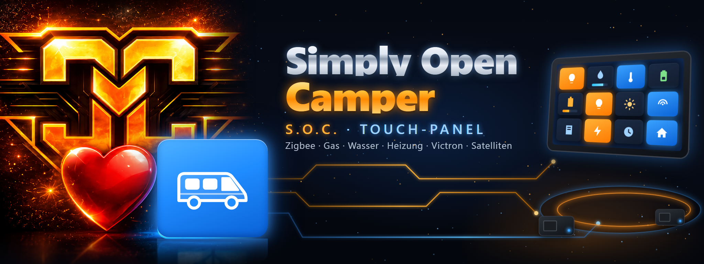

<p align="center">
  
</p>

<h1 align="center"> Simply Open Camper </h1>
<h3 align="center">S.O.C. – touch panel for your camper: Zigbee2MQTT, gas, water, heating and on-board systems – local, no cloud, no Home Assistant</h3>

<p align="center">
  
  
  
  
  
  
  
  
</p>

<p align="center">
  <a href="README.md">🇩🇪 Deutsch</a> · <strong>🇬🇧 English</strong>
</p>

> **Lights, gas, heating and battery on one screen – straight over MQTT, Bluetooth and LIN bus.**

---

## 🚧 Beta – testers and ideas welcome!

The panel runs day to day with Zigbee2MQTT (tested with **131 devices / 73 tiles**). Some modules are built from
open protocol descriptions but have **not been tested on real hardware yet**:
Mopeka with a real sensor, Truma CP Plus, Truma iNet X, Alde, WLED and Cerbo GX.

If you own one of them and want to help: feedback, logs and ideas are very welcome!

---

## 🚀 About

A wall panel with a 7-inch touch screen (1024 × 600) that controls lights and switches from **Zigbee2MQTT directly
over MQTT** – no Home Assistant in between. It also reads gas bottles, tanks, Victron devices and the heating system
of your motorhome. You build the layout in the browser editor served by the panel itself.

> 💡 **How it started:** I run Home Assistant in my own caravan – but just for lights and a few readings, that
> system draws too much power in the long run. I was looking for something more frugal. That is how the panel
> began, as a **light controller for the SMHUB Nano**: a screen on the wall that switches the Zigbee lights directly.
>
> The idea to take it further came from my
> [Truma LevelControl integration for Home Assistant](https://github.com/cyclemat/HAOS-Truma-Levelcontrol-Integration):
> if the panel can read the gas level over Bluetooth by itself, there is no need for Home Assistant for that.
> Then came tanks, Victron, the Truma heater, Alde and satellites – step by step it grew into a control panel
> for the whole camper. Hence the new name: the "Zigbee-Panel" became **Simply Open Camper**.

- 🏠 Everything runs **locally** on the panel – no cloud, no account
- 📶 Own Wi-Fi possible (router mode) – no home network needed, ideal for motorhomes
- 🧩 Every optional module can be built in or left out in `platformio.ini`

> The panel UI is available in German, English, Spanish and French (`lang` in `platformio.ini`).

---

## ✨ Features

**Operation**
- 💡 **Tiles** show the real light colour (colour, white tone, brightness bar). Tap to toggle, long-press for
  brightness, colour temperature, saturation and colour wheel – only where the device supports it.
- 🗂️ **Multiple pages** (swipe or tabs), each with an optional background image (e.g. floor plan).
- ✏️ **Web editor** at `http://<panel>/`: drag & drop devices, sizes, icons, pages, backgrounds, names, settings,
  firmware update over Wi-Fi. Without a panel connection it starts with demo data.
- ⌨️ **Settings on the panel** with an on-screen keyboard (QWERTZ, ä ö ü ß).
- 🌍 **UI in German, English, Spanish or French** – more languages are easy to add.
- 🌙 **Screen saver**: dim, black (easiest on the LCD), dark clock or bouncing logo (your own PNG possible).
- 💾 **Backup to SD card**: layout, names, all settings, sensors, logo and backgrounds.
- 🕐 **Set the clock by hand** when there is no internet; otherwise via internet or browser.
- 🔋 **Battery indicator** in the top bar (level, estimated: on battery / charging / USB full).

**Devices**
- 🐝 **Zigbee2MQTT** – lights and switches, large networks too
- 🔌 **Shelly** (Gen1 and Gen2+) on the same broker
- 🌈 **WLED** on the same broker – on/off, brightness, colour
- ⛽ **Truma LevelControl** over Bluetooth – up to two gas bottles
- 🛢️ **Mopeka** over Bluetooth – up to four gas and tank sensors
- ☀️ **Victron** over Bluetooth ("Instant Readout") – solar chargers, battery monitors, DC-DC chargers
- 🔋 **Victron Cerbo GX** (Venus OS) over MQTT – solar, grid/shore power, charger, battery (SOC) and DC system
- 🔥 **Truma heating** (Combi/VarioHeat) – via **CP Plus** (LIN bus) or **iNet X** (Bluetooth)
- ♨️ **Alde hydronic heating** (Compact 3020, 3030, 3030 Plus) via LIN bus

**Three network modes**

| Mode | Description |
|---|---|
| Network | Panel and hub on your home Wi-Fi |
| Router | Panel opens its own Wi-Fi with DHCP; the SMHUB Nano joins it, the panel finds the broker automatically |
| Combined | Own Wi-Fi for the hub **and** home Wi-Fi, with internet forwarding (NAT) |

---

## 📋 Requirements

- **Waveshare ESP32-S3-Touch-LCD-7B** (1024 × 600, GT911 touch, 8 MB PSRAM)
- MQTT broker with **Zigbee2MQTT** (e.g. SMHUB Nano)
- VS Code with **PlatformIO** (pioarduino, Arduino-ESP32 3.x / ESP-IDF 5.x)
- Optional: microSD card (FAT32/exFAT) for backgrounds and backups
- For CP Plus or Alde: a **LIN transceiver** (TJA1020/TJA1021/MCP2025) and an RJ12 cable

---

## 📦 Installation

1. Install VS Code and PlatformIO, open this folder (path without spaces, e.g. `C:\zp\simply-open-camper`).
2. Connect the board to the USB-C port labelled **"UART"** – that is also where the logs come out.
3. **PlatformIO: Upload** – the **first build takes 10–20 minutes** because the Arduino framework is rebuilt with
   custom settings (XIP from PSRAM against flicker, NAT for combined mode).
4. Before uploading, the terminal waits for **Enter** – time to plug in.
5. The panel then guides you through the setup.

### 🛠 Maintenance and diagnostics

- `tools/embed_web.py` packs the editor gzip-compressed into the firmware on every build.
- `tools/upload_wait.py` waits for Enter before uploading (`PANEL_UPLOAD_NOWAIT=1` disables it).
- `pio run -e check-all` builds a test variant with **all** modules (not meant for uploading).
- Only needed if you change fonts, icons or the editor:

```sh
node tools/gen_icons.js        # icons (needs react-icons + sharp)
python3 tools/gen_fonts.py     # LVGL fonts from Inter + icons
python3 tools/build_editor.py  # web/editor.src.html -> web/editor.html
```

---

## ⚙ Configuration

### Enabling and disabling modules (`platformio.ini`)

| Section | Switch | Meaning |
|---|---|---|
| `[features]` | `wled = 1` | WLED over MQTT |
| | `cerbo = 1` | Victron Cerbo GX over MQTT |
| | `lang = de` | Language of the panel UI: `de`, `en`, `es`, `fr` |
| `[truma]` | `cpplus = 0` | Truma CP Plus over LIN (transceiver required) |
| | `lin_uart`, `lin_rx`, `lin_tx`, `lin_en` | LIN connection for the CP Plus (default UART2) |
| | `inetx = 1` | Truma iNet X over Bluetooth (switch on/off in the settings) |
| `[alde]` | `enabled = 0` | Alde over LIN (the panel is LIN master) |
| | `model` | `3020`, `3030` or `3031` (= 3030 Plus) |
| | `baud`, `checksum` | 19200 / auto; possibly 9600 on the 3020 |
| | `lin_uart`, `lin_rx`, `lin_tx`, `lin_en` | LIN connection (CP Plus and Alde need separate UARTs) |
| | `red_uart`, `red_rx` | 3030 only: internal bus, read-only (−1 = off) |

Truma LevelControl, Mopeka and Victron are always built in and switched on or off on the panel under
**Einstellungen → Gas/Heizung** or **Victron**. Disabled protocols are not scanned and don't load radio and Wi-Fi.

### 🌍 Languages & dictionaries

| Part | Languages | Selection | Dictionary | Tool |
|---|---|---|---|---|
| **Panel** (screen) | German, English, Spanish, French | `lang` under `[features]` in `platformio.ini` | `src/i18n/<code>.h` | `tools/i18n_update.py` |
| **Browser editor** | German, English | automatically like the panel, or `http://<panel>/?lang=en` | `web/i18n/<code>.json` | `tools/i18n_editor.py` |

The texts in the source code are German – they are also the **key** in the dictionary. If a translation is
missing, the German text is shown; nothing breaks. Device names are never translated.

#### 📖 Panel dictionary (`src/i18n/<code>.h`)

One line per text: German on the left (do not change), translation on the right, followed by the source location.

```c
{"Einstellungen", "Settings"},                       // src/ui/ui_settings.cpp:1424
{"vor %ld Min.", "%ld min ago"},                     // src/ui/ui_gas.cpp:29
{"Kein Echo – Sensor richtig angebracht?", ""},      // empty = stays German
```

**New language** (e.g. Italian):

1. `python tools/i18n_update.py it` – creates `src/i18n/it.h` with all texts (right side empty).
2. Translate the right side.
3. Set `lang = it` in `platformio.ini` and build.

#### 📖 Editor dictionary (`web/i18n/<code>.json`)

A JSON object: German text → translation. `{}` stands for a variable part (number, name …) and is inserted into
the translation in the same order.

```json
{
 "Einstellungen": "Settings",
 "vor {} Min.": "{} min ago",
 "„{}“ heißt danach überall „{}“ – auch in Home Assistant.": "“{}” will then be called “{}” everywhere – including Home Assistant."
}
```

**New language** (e.g. French):

1. `python tools/i18n_editor.py fr` – creates `web/i18n/fr.json` with all texts (translations empty).
2. Translate the values.
3. Run `python tools/i18n_editor.py` again – it injects the dictionaries into `web/editor.src.html` and
   `web/editor.html`. Then build and upload.

#### ✍️ Rules for translators

- **Never change the left side / the key** – that is how the text is found in the code.
- **Keep placeholders:** on the panel `%s`, `%d`, `%u`, `%ld`, `%.1f`; in the editor `{}`. Count and order must match.
- **Keep leading/trailing spaces** (e.g. `"  ·  Boiler "`) – such pieces are combined with other texts.
- The panel fonts cover the Latin-1 range (á é í ó ú ñ ç à è ê ü ß …), but e.g. not "œ" and no non-Latin scripts.
- **New texts in the code:** `python tools/i18n_update.py` or `python tools/i18n_editor.py` add them to every
  dictionary; with `--report` they only show what is missing.

Pull requests with new or improved translations are very welcome!

### SMHUB Nano

- **Network mode:** On the Nano, enable "Allow External" under **Settings → MQTT**. Enter the Nano's IP on the
  panel (port 1883, base topic `zigbee2mqtt`).
- **Router mode:** On the panel choose **Netzwerk → Router** (the panel restarts). On the Nano select the panel
  Wi-Fi (2.4 GHz) – name and password are shown on the panel. The editor is then at `http://192.168.4.1/`.
- **Radio channels:** Wi-Fi and Zigbee share 2.4 GHz. Zigbee2MQTT uses channel 11 by default → keep the panel
  Wi-Fi on 13. In combined mode the panel Wi-Fi follows the channel of your home Wi-Fi.

---

## 📡 Setting up devices

### ⛽ Truma LevelControl

- The sensor only advertises every few minutes and allows **one connection at a time**. If the Truma app,
  Home Assistant or the Victron GX is connected, the panel retries on the next round.
- Scanning runs up to three minutes; polling interval 5 to 60 minutes (default 10).
- The last reading survives restarts.

### 🛢️ Mopeka

- Supported: Pro Check, Pro Plus, Pro Check Universal, Pro Check H2O, Lippert BottleCheck, Pro-200, TD40/TD200 and
  the older Standard sensors. The panel only listens – the Mopeka app keeps working.
- While scanning, briefly press the **sync button** on the sensor – it is then marked "Taste gedrückt".
- Choose the bottle type in the detail view: 6/11/14 kg (Europe), 20/30/40 lb (US) or custom values (mm, kg/l).

### ☀️ Victron

- Enable **Instant Readout** in VictronConnect (**Settings → Product info → Instant Readout**).
- Paste each device's key from **Show details** into the editor or type it on the panel.
- Read-only – Instant Readout cannot switch anything.

### 🔋 Victron Cerbo GX

- On the GX enable **Settings → Services → MQTT** (plain, port 1883).
- Enter the GX IP address on the panel under **Einstellungen → Victron** or in the editor. The panel detects the
  portal ID itself; a password is only needed if one is set on the GX for the local network.
- The panel connects directly to the GX (its own MQTT connection, independent of the Zigbee2MQTT broker),
  subscribes only to the values it needs and keeps the GX publishing with a keepalive.
- Five tiles: **Solar** (PV power, charge state, yield today), **Grid** (power, voltage, current limit),
  **Charger** (Multi/Quattro or mains charger: state, switch, power), **Battery** (SOC, voltage, power,
  time to go) and **DC system** (load power).
- Read-only – switching (e.g. inverter mode) is not built in yet.

### 🔥 Truma heating

- **CP Plus:** LIN transceiver on the UART header (switch set to "UART"), LIN to RJ12 pin 3, ground to pin 5
  (on the Combi or via a splitter). Then run **PR SET → Init** once on the CP Plus.
- **iNet X:** Enable the protocol in the settings, tap **"iNet X koppeln"** and then open **"Add device"** on the
  control panel (3 minutes). The iNet X remembers at most four devices.

### ♨️ Alde

- Connect the LIN wire to the **yellow RJ12 socket** (pin 4, ground pin 2) and enter model and pins under `[alde]`.
- The panel polls the boiler every 500 ms and only sends on changes – settings on the Alde panel stay valid.
- Compact 3020 HE: as far as known it can only be read, not controlled – not supported.

### 🌈 WLED

- In WLED enable **Config → Sync Interfaces → MQTT**, enter the same broker and keep the device topic
  `wled/<name>`. The panel discovers the devices automatically.
- Colour temperature and effects are not available over MQTT – keep using the WLED app for those.

---

## 🛰️ Satellites

A satellite is a cheap **ESP32 (esp32dev, e.g. ESP32-WROOM)** that you place anywhere in the vehicle – at the gas
locker, under the bed next to the fresh water tank, in the utility compartment. It reads Bluetooth devices and its own
sensors and sends the values to the panel. This saves memory and radio time on the panel (Bluetooth and Wi-Fi share
one antenna there) and bridges distances Bluetooth alone cannot cover.

**What a satellite reads and switches**

| Type | Capacity | Notes |
|---|---|---|
| ⛽ Truma LevelControl, 🛢️ Mopeka, ☀️ Victron | via Bluetooth | same modules as in the panel |
| 💧 Tank probes | up to 4 tanks, up to 5 probes each | rods of different lengths, each with its own percentage step |
| 🌡️ DS18B20 | up to 8 sensors on one GPIO | 1-Wire, search sensors with a button, offset per sensor |
| 📈 Analog | up to 4 inputs (GPIO 32–39) | two points to convert mV into the value |
| 📐 MPU-6050 (GY-521) | tilt, lengthwise and crosswise | zero point via button, smoothing see below |
| 🔌 Switches | up to 8 outputs (relays) | active low selectable, state after boot: off / on / last |
| 🔘 Inputs | up to 8 contacts or buttons | pull-up and invert selectable |

**Three ways to the panel** – each can be enabled on the satellite:

- **Bluetooth** straight to the panel, no Wi-Fi needed. Encrypted (AES-CTR) with one shared password for all
  satellites. The panel adopts satellites with a matching password automatically.
- **MQTT** via the broker, with **Home Assistant discovery** – so the values also show up in Home Assistant.
  Topics: `panelsat/<id>/sensor/<point>`, switch with `panelsat/<id>/switch/<point>/set` (`ON` / `OFF` / `TOGGLE`).
- **UDP** (port 47811) as broadcast or to a fixed panel IP.

The panel needs `satellites = 1` under `[features]` in `platformio.ini` (default).

### Setup

1. Flash the firmware: `pio run -d satellite -t upload` (the satellite is a separate PlatformIO project in the
   `satellite/` folder; in VS Code it is the second folder "Satellit" in the workspace).
2. Without Wi-Fi access the satellite opens the Wi-Fi **"SOC-Satellite-…"** (password `panelsat`).
   Connect and open **http://192.168.4.1/**.
3. In the web UI set up Wi-Fi, the way to the panel and the Bluetooth password, then add Bluetooth devices and assign
   the GPIOs. The web UI shows what each pin can do and warns about boot pins (0, 2, 5, 12, 15) and double use.

### 💧 Tank probes

Several stainless steel rods of different lengths in the tank plus a shared ground rod. When water touches a probe it
conducts to ground; the highest step with contact is shown (e.g. 20 / 40 / 60 / 80 / 100 %).

- **One GPIO per probe** – the simplest way. The ground rod goes to GND or to its own GPIO.
  For modules with a transistor there is "contact = high".
- **Resistor ladder on one analog pin** – all probes on one pin through resistors. In the web UI you enter the
  measured voltage for each step; the satellite picks the closest one.
- **Against corrosion** the probes are only powered briefly while measuring (own interval, default 60 s) and are
  unpowered otherwise. Each probe is read three times, the majority wins.
- If a higher probe is wet and a lower one dry, the satellite reports the value as **implausible** – usually a dirty
  rod or a wiring fault.

### 📐 Calming the tilt reading (MPU-6050)

Something always moves in a camper: people walking around, wind pushing. To keep the value from jumping, the
satellite smooths in several stages – all adjustable in the web UI:

| Stage | Default | Effect |
|---|---|---|
| Low-pass in the sensor | 5 Hz | filters vibration inside the MPU-6050 already |
| Median | last 5 values | single outliers are dropped |
| Time filter | 2 s | moving average (0 = off) |
| Dead band | 0.2° | smaller changes are not reported |
| Only when still | from 3 °/s | while the sensor rotates (gyro), the last value is held until 1 s of rest |

Set the **zero point** with a button while the vehicle is level. Axes can be swapped and inverted if the board is
mounted the other way round.

---

## ⚠ Known limitations

| Problem | What to adjust |
|---|---|
| Picture flickers/drifts | Lower `LCD_PCLK_HZ` in `src/app_config.h` to 21 or 18 MHz |
| Touch mirrored/rotated | `TOUCH_SWAP_XY`, `TOUCH_INVERT_X/Y` in `src/app_config.h` |
| Bounce buffer artefacts | Set `LCD_BOUNCE_BUFFER_PX` to 0 |
| No MQTT in router mode | "Allow External" enabled on the Nano? Broker running? Status is shown under **Info** |
| SD card not detected | Format FAT32/exFAT, restart the panel; if needed lower `SD_FREQ_KHZ` |
| Panel restarts with large Zigbee networks | Check the log on "UART"; "Interner RAM knapp" shows where memory gets tight |
| No log on the PC | Use the **"UART"** port, not "USB" |
| Missing umlauts | Run `python3 tools/gen_fonts.py` again |
| `IncompatiblePlatform … 6.2.0-post.1` | Install `pioarduino==6.2.0` in PlatformIO's Python (pioarduino issue #563) |
| `whitespace character in project paths` | Move the project to a path without spaces |

- The board doesn't report whether USB power is present – "USB / battery" is estimated from the voltage trend.
  The 7B has no RTC chip; without internet the time is lost on power failure.
- The 7B's UART header shares its interface with RS485 (switch on the board).

---

## 🔌 REST API

Used by the editor, also handy for your own scripts:

| Endpoint | Purpose |
|---|---|
| `GET /api/info`, `GET /api/devices` | Panel state, device list |
| `GET\|POST /api/layout` | Layout (`?force=1` on conflict) |
| `POST /api/rename` | `{ieee, name}` rename in Zigbee2MQTT |
| `GET\|POST /api/bg?page=<id>&fmt=jpg` | Background (JPEG 1024 × 600, `&delete=1`) |
| `GET\|POST /api/backup` | `{"create":true}`, `{"restore":"<name>"}`, `{"delete":"<name>"}` |
| `GET\|POST /api/settings` | Settings, incl. `{"ble":{"truma","mopeka","victron","inetx"}}` |
| `POST /api/wifi`, `/api/time`, `/api/refresh`, `/api/reboot`, `/api/saver` | Wi-Fi, time, reload, restart, screen saver |
| `POST /api/ota` | Firmware update (firmware.bin) |
| `GET\|POST /api/saver_logo?fmt=bin\|png` | Custom logo (`&delete=1`) |
| `GET\|POST /api/truma` | `{"scan":true}`, `{"measure":"<mac>"}`, `{"add":{mac,type,name}}`, `{"remove"}`, `{"rename"}`, `{"interval"}` |
| `GET\|POST /api/mopeka` | `{"scan":true}`, `{"add":{mac,name,tank}}`, `{"remove"}`, `{"rename"}`, `{"tank":{mac,tank,empty,full,capacity}}` |
| `GET\|POST /api/victron` | `{"scan":true}`, `{"add":{mac,key,name}}`, `{"key":{mac,key}}`, `{"remove"}`, `{"rename"}` |
| `GET\|POST /api/heat` | `{"src":"cpplus"\|"inetx"\|"alde", "heat":{on,target,mode}, "water", "energy":{e,power}, "clock", "pair", "forget"}` |

---

## 🧩 Protocols & related projects

The device protocols are based on these open projects. What was taken is the **protocol description** (byte
layout, constants, sequences) – the code here is an independent C++ implementation, no source code was copied.
Many thanks to the authors!

| Module (file) | Reference | Licence of the reference | Used for |
|---|---|---|---|
| Truma LevelControl (`src/truma.cpp`) | [cyclemat/HAOS-Truma-Levelcontrol-Integration](https://github.com/cyclemat/HAOS-Truma-Levelcontrol-Integration) | GPL-3.0 | Password/RC4 key, measurement sequence |
| Mopeka (`src/mopeka.cpp`) | [esphome/esphome](https://github.com/esphome/esphome) – `mopeka_pro_check`, `mopeka_std_check` | GPL-3.0 (C++) / MIT (Python) | Pro/Standard packet layout, temperature compensation, echo evaluation, tank dimensions |
| | [Bluetooth-Devices/mopeka-iot-ble](https://github.com/Bluetooth-Devices/mopeka-iot-ble) | MIT | Model list, medium coefficients (air, water) |
| Truma CP Plus (`src/truma_cpplus.cpp`) | [danielfett/inetbox.py](https://github.com/danielfett/inetbox.py) | GPL-3.0 | LIN frames, diagnostic services, status buffers, encoding |
| | [Fabian-Schmidt/esphome-truma_inetbox](https://github.com/Fabian-Schmidt/esphome-truma_inetbox) | GPL-3.0 | Registration, buffer layouts, ESP32 timing |
| | [muccc/WomoLIN](https://github.com/muccc/WomoLIN) | see project | Early decoding of the Truma LIN protocol (via the two above) |
| Truma iNet X (`src/truma_inetx.cpp`) | [rpodgorny/hass-truma-inetx](https://github.com/rpodgorny/hass-truma-inetx) | GPL-3.0; its bundled protocol files come from [daaaaan/truma-inetx-ble](https://github.com/daaaaan/truma-inetx-ble) **without a licence** | GATT characteristics, transfer sequence, frames, topics/parameters |
| Alde (`src/alde.cpp`) | [daviddootson/alde_3030_plus](https://github.com/daviddootson/alde_3030_plus) | MIT | Bus layout, control and info frames, red bus (glycol/hot water) |
| | [holdestmade/esphome-alde-3020](https://github.com/holdestmade/esphome-alde-3020) | MIT | 3020 specifics, checksum detection, timing |
| | [darenshaw/truma-inet-x-to-alde-3020](https://github.com/darenshaw/truma-inet-x-to-alde-3020), [inetbox.py issue #28](https://github.com/danielfett/inetbox.py/issues/28) | GPL-3.0 / – | Notes on models and limits (3020 HE) |
| WLED (`src/wled.cpp`) | [WLED – MQTT interface](https://kno.wled.ge/interfaces/mqtt/) | EUPL-1.2 (WLED) | Topics and commands |
| Cerbo GX (`src/cerbo.cpp`) | [victronenergy/dbus-flashmq](https://github.com/victronenergy/dbus-flashmq), [dbus API in the Victron wiki](https://github.com/victronenergy/venus/wiki/dbus) | see project | Topics, keepalive, value paths |

If you redistribute this firmware, keep the licences of the references in mind. For the iNet X, the original
protocol analysis has no licence. This is not legal advice.

**Libraries used:** Inter font (SIL Open Font License 1.1), Phosphor icons (MIT), LVGL (MIT), ArduinoJson (MIT),
NimBLE-Arduino (Apache 2.0).

---

## 🛠 Feedback & contributions

- Please report bugs and ideas as issues – ideally with a log from the "UART" port
- Pull requests are welcome
- Tested Mopeka, CP Plus, iNet X, Alde, WLED or Cerbo GX? Let me know – even if it doesn't work!

---

## ❤ Support & donations

This project is built in my spare time. If it helps you, I'd be happy about a coffee:

**[☕ PayPal – support CycleMat](https://paypal.me/cyclemat)**

No pressure, no ads, no paywalls – just open source and passion ❤

---

## 📄 Trademark notice

**Private, community-driven hobby project.**

- Not affiliated with Truma, Alde, Mopeka, Victron Energy, WLED, Shelly, Waveshare or Zigbee2MQTT.
- "Truma", "LevelControl", "iNet", "Alde", "Mopeka", "Victron", "WLED" and "Shelly" are trademarks or names of their
  respective owners and are only mentioned to describe compatibility.
- The project only connects to your own devices.
- Use at your own risk – especially when working on heating and gas systems.

---

<p align="center"><strong>CycleMat · Your lights. Your heating. Your panel.</strong></p>
