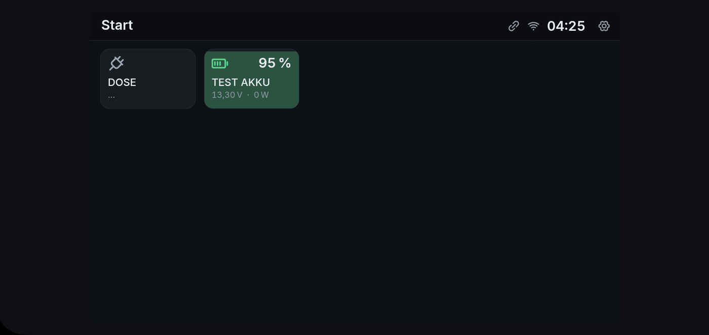
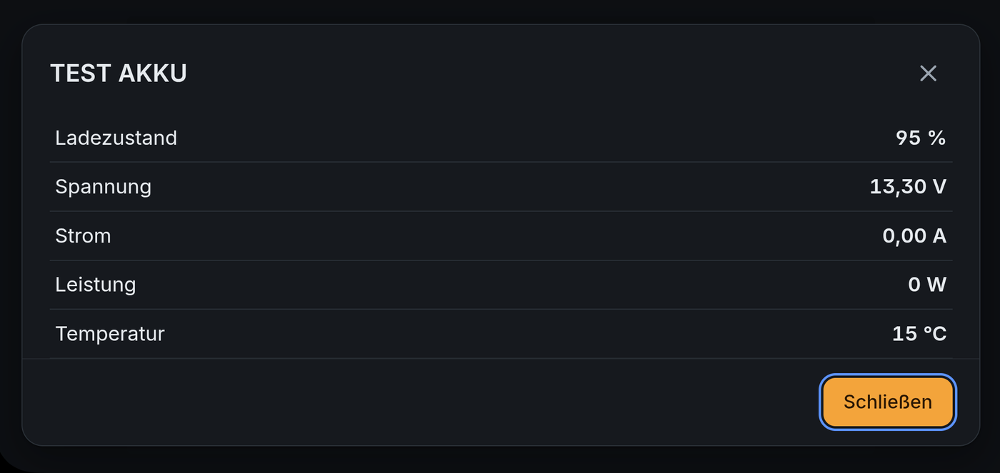

# App „S.O.C. Live“ (Android)

### 📲 App „S.O.C. Live“ (Android) *(Beta)*

Das Panel aufs Handy – zu Hause, auf dem Campingplatz und unterwegs über Mobilfunk. Die App zeigt die Kacheln **genau
so, wie das Panel sie berechnet** (Werte, Farben, Pegel), quer über den ganzen Bildschirm.

 

- **Antippen** schaltet Licht und Steckdosen; bei Messwerten (Akku, Victron, Gas, Heizung, Sensoren) öffnet sich ein
  Fenster mit **allen Werten** – beim Akku z. B. Ladezustand, Spannung, Strom, Leistung, Temperatur und Zellen.
- **Lange drücken** auf ein dimmbares Licht: Helligkeit.
- **Tailscale ist eingebaut** – die Tailscale-App wird nicht gebraucht, kein offener Port am Router.
- Das Zugangspasswort des Panels gibst du einmal ein, die App merkt es sich (nur auf dem Handy).

**Installieren und einrichten**

1. [`release/soc-live.apk`](https://github.com/cyclemat/simple-open-camper/blob/main/release/soc-live.apk) aufs Handy laden und öffnen (Android 7 oder neuer, 64 Bit;
   „Installation aus unbekannten Quellen“ einmal erlauben).
2. Hinweise lesen und bestätigen.
3. **„Mit Tailscale anmelden“** – der Browser öffnet die Tailscale-Anmeldung, das Handy erscheint als **soc-live** in
   deinem Tailnet. Noch kein Konto? **„Tailscale-Konto erstellen“** (für private Nutzung kostenlos).
4. Die App **sucht das Panel im Tailnet** und verbindet sich; bei mehreren Panels tippst du es an.
   Voraussetzung: am Panel ist Tailscale an, mit demselben Konto (siehe [Tailscale](Tailscale)).
5. Beim ersten Mal fragt das Panel nach seinem Zugangspasswort – fertig.

**Ohne Tailscale** (nur im WLAN des Panels bzw. im selben Netz): beim ersten Start „Ohne Tailscale – nur im WLAN“ und
die Adresse eintragen (Panel-WLAN: `192.168.4.1`, sonst die IP aus Einstellungen → Netzwerk).

**Einstellungen:** Zurück-Taste **lange** drücken – Adresse, Tailscale an/aus, Panel neu suchen, Auth-Key (statt
Browser-Anmeldung), Bildschirm anlassen, Vollbild, gespeichertes Passwort löschen, von Tailscale abmelden.
Tailscale läuft nur, solange die App genutzt wird (nach 2 min im Hintergrund aus).

---
*Diese Seite wird aus der [README](https://github.com/cyclemat/simple-open-camper) erzeugt (`tools/make_wiki.py`) – Änderungen bitte dort.*
