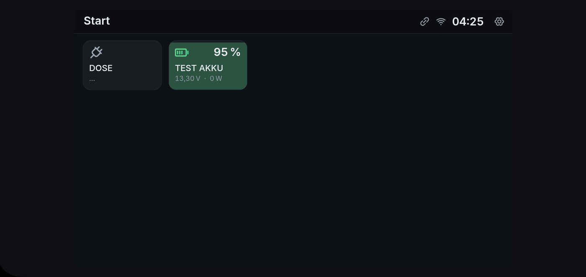
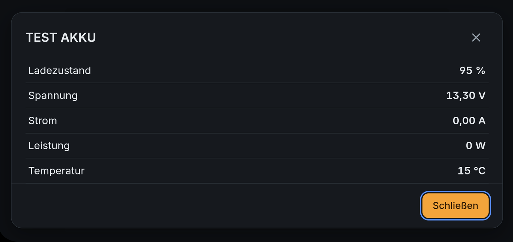

# Live-Ansicht

### 📱 Live-Ansicht (Panel im Browser bedienen)

- **`http://<panel>/live`** (bzw. Knopf **„Live“** oben im Editor) zeigt das Panel mit seinen Seiten und Kacheln im
  Browser – **Antippen schaltet**, **lange drücken** öffnet Helligkeit bzw. Ein/Aus. Werte frischen sich alle 1,5 s auf.
- Geschützt durch das **Zugangspasswort** (wie der Editor). Am Handy „Zum Startbildschirm hinzufügen“ – dann startet
  sie wie eine App; quer gehalten wird das Panel größer. Mit **Tailscale** auch von unterwegs
  (`http://<name-im-tailnet>/live`).
- Kostet am Panel nur Rechenzeit, solange jemand zuschaut; geschaltet wird über dieselben Wege wie am Bildschirm.
- **Android-App „S.O.C. Live“** *(Beta)*: [`release/soc-live.apk`](https://github.com/cyclemat/simple-open-camper/blob/main/release/soc-live.apk) aufs Handy laden und
  installieren (Installation aus unbekannten Quellen erlauben). **Tailscale ist eingebaut** – die Tailscale-App wird
  nicht gebraucht: beim ersten Start „Mit Tailscale anmelden“ (Browser), danach sucht die App das Panel im Tailnet und
  verbindet sich (am Panel muss Tailscale an sein, gleiches Konto). Ohne Tailscale: Adresse im WLAN eintragen.
  Das Panel-Passwort fragt das Panel einmal ab, die App merkt es sich. Die App zeigt die Kacheln genau wie das Panel
  (quer, ganzer Bildschirm); Antippen schaltet bzw. zeigt bei Messwerten alle Werte (z. B. Akku mit Zellen). Zurück-Taste
  lange drücken = Einstellungen.
  
 

---
*Diese Seite wird aus der [README](https://github.com/cyclemat/simple-open-camper) erzeugt (`tools/make_wiki.py`) – Änderungen bitte dort.*
